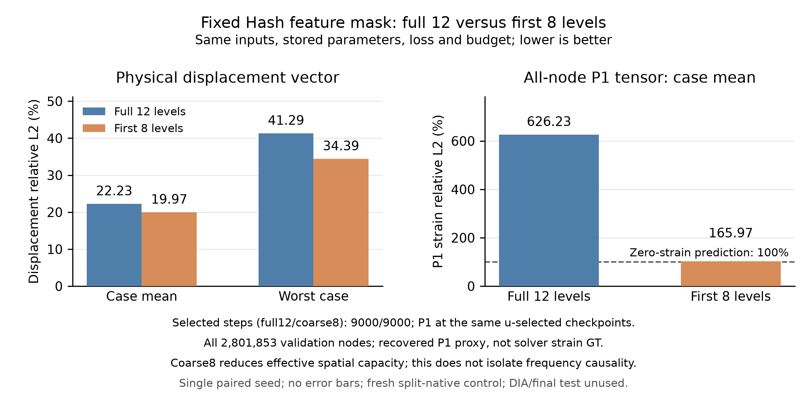
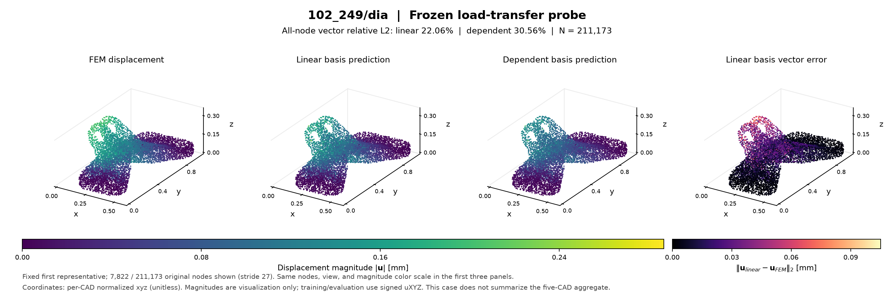

# GeoBC：原版 DeepJEB 复现与泛化探索

**当前阶段（2026-10-09）：六家族初筛、双种子成本确认及一次冻结最终验证完成；自主研究与30分钟监视继续。** 原30项slides复现已完成并发布；后续探索完成66个阶段（63项真实数据训练／诊断与输入准备、3项合成接口验收）。先读[求解器简报](results/SOLVER_BRIEF.md)。用户尚未选择Hash或其它solver，未启动的Hash梯度监督pilot保持暂缓。

**现有证据支持Hash的小样本拟合能力，尚不支持将它选定为GeoBC求解器。** 原实验主要测训练拟合，此前探索集中于Hash；现在已补上共同CAD划分下的六家族初筛，尚需成本确认与最终检验。关闭Hash最后4层曾把旧开发验证位移均值22.23%降至19.97%，但应变代理仍差；它与本轮signed四场预测的配方不同，不能直接拼成跨架构排名。[选型计划](notes/geobc_solver_selection_plan.json)记录初筛范围。

首轮各480次完整案例更新，**FNO验证位移／应力47.5%／66.7%，是当前最有潜力的路线**；MLP为71.6%／97.6%，作为低成本对照。Hash为92.5%／92.8%，但最差位移191.4%且后半程位移反升，因此暂缓；三种Transolver仍接近零场基线。完整共同checkpoint与曲线见[六家族简表](results/solver_selection/BRIEF.md)。四次训练遍历不足以证明收敛；各家原生容量差异及FNO point-to-grid插值限制均明示。

已完成[固定成本确认](notes/geobc_solver_confirmation_plan.json)：FNO、MLP和一条低优先级慢结构路线Transolver++，各用2026／2027两个种子、每项累计600训练秒，串行队列共62.3分钟。2026从screen最后一步继承模型、Adam与全部RNG，父阶段时间计入600秒；2027重新初始化，复用相同数据、几何云与仅TRAIN拟合的scaler。完整120-case pass末停止并记录超预算时间，固定成本端点为主要比较，共同VAL-best另报；未改损失或家族参数。见[确认报告](results/solver_confirmation/BRIEF.md)。

两个seed的固定预算端点U／stress分别为FNO **36.28%／56.45%、36.22%／56.07%**，MLP **51.69%／75.62%、43.01%／73.24%**，++ **90.32%／98.45%、103.55%／98.57%**。FNO在这套配方与预算下最有依据，MLP保留为点式低成本对照；两seed不是统计显著性证明。FNO共同VAL-best第2640步分别为25.07%／55.44%、26.28%／55.05%；后段位移回退，因此端点与best分别报告。

最终评估的隔离入口已完成[源码检查](notes/solver_final_eval_source_check.json)，[规则](notes/geobc_solver_final_eval_plan.json)已在读取最终数据前冻结：FNO／MLP、两个seed、固定预算端点为主及既有VAL-best为次。输入准备6.1秒，160次全节点case推理及评估51.1秒，零训练、零scaler拟合。[final5结果](results/solver_final_eval/BRIEF.md)按known3与dia分栏：已知载荷FNO U33.09–36.17%／S49.23–50.39%，MLP U26.53–49.40%／S64.20–73.49%。MLP一个seed位移更低，FNO应力及跨seed表现较稳定，不能宣称所有指标都赢。

组合载荷dia的FNO U46.43–76.51%／S68.78–96.31%，MLP U57.71–131.70%／S84.19–98.90%，仍明显不足。最终结果不用于选seed、checkpoint或重训；后续适配研究需要独立未使用的评估集。GINO仅作为[有界候选建议](notes/solver_gino_candidate_design.md)记录，尚未安装或实验。

固定TRAIN案例的179,316个节点完成网格边界角色回查（1.7秒）：支持／载荷角色正节点重建均值为0.390／0.379，局部标记受到明显稀释。角色是描述符，非精确节点Dirichlet；这项输入诊断不证明预测误差的原因。原生连续查询和完整十节点运动学代理仍需另行验收。

新增拓扑邻居消息的四几何拟合对照用时56.6秒：位移10.59%→12.87%，P1约219%→219%，没有通过联合门限。两组初始化、采样、实际参数与首反向核对通过；这一固定预算结果不代表所有拓扑方法都无效。

连续查询几何接口已在一个TRAIN案例通过有界验收（45.1秒）。后续冻结场全CAD诊断（3.1秒）发现，同一案例的四角P1／完整十节点位移派生应变代理误差为22.4%／187.3%。这提示单看节点位移或P1会遗漏梯度问题；它不是solver应变GT，也没有证明所有Hash都存在同样缺陷。该发现保留为候选求解器后续一致检验的依据，当前不继续Hash专属局部优化。



单CAD位移／P1代理可拟合到0.76%／17.9%；可靠跨几何预测仍未解决。先读 [一分钟结果](results/geobc_exploration/BRIEF.md)；详细证据见 [探索报告](results/geobc_exploration/REPORT.md)，执行计划见 [notes/geobc_exploration_plan.json](notes/geobc_exploration_plan.json)。

GeoBC Neural Operator 研究根据几何、材料、载荷和约束预测空间坐标处的位移与应力。当前已实现整体点云、局部边界几何及位移载荷响应基；未见 CAD 预测误差仍高，也未验证重网格泛化。研究主线是以几何和边界接口条件化连续场，同时保留应力集中处的局部细节；具体新方法及其有效性需要后续验证。



上图固定使用第一个代表案例102_249/dia，显示同一批7,822个原节点，前三面板共用位移模长mm色标。模长仅用于可视化，训练及指标使用原始signed uXYZ；此单案例不代表五CAD汇总。

使用 **原版 DeepJEB v1.0**，复现 [参考 slides](https://docs.google.com/presentation/d/1g5S0QCZSDR_igYFWFe20SQ3nw2yvgYbXk_t4QSmKpBU/edit) 的可恢复量化实验，优先单样本和五样本。30/30 个计划实验已完成，正式队列用时约3小时26分钟。完整本地结果见 [ALL_METHODS_RESULTS.md](ALL_METHODS_RESULTS.md)，可移植结果包见 [results/REPORT.md](results/REPORT.md)，全部运行命令见 [notes/all_methods_plan.json](notes/all_methods_plan.json)。每项完成状态和实际物理指标保存于对应 `summary.json`。

主要观测：坐标 MLP 单案例应力 L2 为39.52%；官方 FullyFused hash 单案例为0.414%，五案例平均/最差为1.450%/2.112%；192³ FNO 回查原始节点为14.34%。替代50案例共享场平均 L2 从24.43%降到16.17%（pooled13.94%，最差28.97%，最佳 epoch810）。TS3 长预算 pooled应力L2为74.40%，未达到原稿数值；其历史架构/优化配置缺失，不能把这次结果视为原 run 的精确重放。

原实验目录已不可访问。已恢复的案例、模型尺寸、输入/输出及更新预算按 slides 执行；缺失的学习率、缩放常数、部分模型配置和条件特征定义均在每次运行的配置中明示。不能把替代配置的结果称为原代码的精确数值复现。

> **数据对齐更正：旧 H5-only 结果已撤回物理场结论。** H5 中的节点场数组与 `vertices` 的排列不同，旧流程未核对逐节点对应。新数据按官方 Field CSV 的 GRID 坐标对齐到 H5 节点，训练入口拒绝没有对齐标记的数据。旧文件保留在 `data/prepared`、旧 `runs` 和 `plots/final`，仅供历史记录；[REPRODUCTION_REPORT.md](REPRODUCTION_REPORT.md) 已标注撤回。

## 实验范围

30 个实验包含 MLP、4-level NGP 的应力/位移拟合、12-level hash grid、官方 tiny-cuda-nn FullyFusedMLP、Transolver、Transolver++、Transolver-3，以及冻结 NGP 加 TS3/++ 输出残差、FNO 64³ 联合/应力输出、FNO 192³ 应力输出、FNO→hash 蒸馏和共享 50 样本 hash grid 两个训练阶段。单样本、双样本、五样本各自列出，避免混淆预算和案例。

Slides 第 2 页提到的 Geometry+BC 分支、mesh-flow prior、geometry-latent TS3、BenchCAD 和 FNO 分支仅有历史概述，没有可运行配置或量化源记录，报告列为不可恢复项。

| 数据目录 | 用途 | 原始 FEM 节点数 |
| --- | --- | ---: |
| `data/prepared_exact_multifield` | 原稿 `506_533/ver`、`506_25/tor` | 243,564 |
| `data/prepared_benchmark5` | 上述两个加 `10_30/ver`、`10_421/hor`、`10_460/dia` | 791,820 |
| `data/prepared50_multifield` | 官方压缩包前 50 个 CAD，循环分配四种载荷 | 10,684,820 |

50 样本原先的 270-CAD 训练池及抽样列表缺失，当前集合明确作为替代集合。全局 batch 51,200 对应每 epoch 209 次更新；1000 个真实 epoch 共 209,000 次更新。随机采样阶段结束后只继承最佳权重，重新初始化 Adam。

数据来源是 [官方 DeepJEB 站点](https://dataset.narnia.ai/deepjeb.html) 的原版 Drive 文件和 [KAIST 官方镜像](https://huggingface.co/datasets/KAIST-SmartDesignLab/DeepJEB)，镜像 revision 固定为 `160424ca2a5095315ff9ead8a5fc36d2667fd3c6`。原稿两个案例的六个源文件及 SHA256 在 `references/deepjeb_exact_files.json`；全部准备参数在各数据目录的 `manifest.json`。

uXYZ 和有符号应力直接来自 CSV，不改变源符号。25 个条件特征由 FEM 几何、载荷、材料、约束接口计算，不包含标签或样本 ID；这是记录完整的替代 schema。水平载荷和扭矩采用实际 FEM 中的 −x 和 +z。二次 TETRA10 原始节点保留，绘图从体单元提取二次边界面。

## 配置与评估

Transformer 使用固定提交的官方实现，见 `third_party/transformer_sources.json`。Transolver++ 采用 slides 的 16×256；TS3 未公开尺寸，采用官方 volume preset。完整案例共享全局 context，TS3 的分块保留全局两遍计算。冻结 NGP 仅加在残差模型输出，不作为输入。

主要 hash 配置为 12 层、每层 2 特征、log2 表上限 19、base 8、growth 1.6，64 宽、2 隐藏层 ReLU。官方 FullyFusedMLP 与 Triton 编码加 PyTorch MLP 分开列出；前者原生 FP16 网络，后者 FP32。单样本只输入 xyz，多案例增加 25 个条件特征。每更新均匀抽取每案例 16,384 节点，1000 次随机更新不称为 1000 个 epoch。

Stress asinh 使用记录在配置中的 pooled P90 尺度、中心和标准差，严格逆变换后计算物理单位指标。所有节点模型评估全部原始 FEM 节点，报告 physical relative L2、案例均值/最差值、最高绝对应力的 1% 热点及位移向量误差。检查点选择标准在各配置中记录，不延长原稿预算来替换主要比较。

FNO 使用真实 TETRA10 二次插值构建网格；64³ 和 192³ 使用同一物理域，192³ 间距为 0.954956 mm。原网格原点缺失，当前采用居中补齐的 182.396596 mm 立方域，作为显式假设。occupied-grid、回查 FEM、真值网格往返及蒸馏 teacher/FEM 指标分开报告。蒸馏只以 teacher 标签训练和选择检查点。

上述30项 slides 实验评估训练案例的拟合能力。独立的 GeoBC 探索阶段已开展迁移诊断与按CAD隔离的验证，结果见探索报告；新模型的最终测试字段未参与训练或选模；原50案例历史实验使用过部分同CAD，不能称为全局从未观察的盲测。

## 运行

本机环境为 WSL `cold-surge-ubuntu-24.04`、Python `/home/research/.venvs/geobc`、RTX 5090 32 GB。锁定依赖见 `requirements-lock-wsl.txt`，tiny-cuda-nn 编译说明见 [notes/install_tcnn.md](notes/install_tcnn.md)。以下命令在 WSL 项目目录执行。

```bash
# 查看全部配置；已完成实验会复用
python tools/run_slides_suite.py --dry-run
# 顺序运行 GPU 阶段，复用已完成实验
python tools/run_slides_suite.py
# 只执行指定阶段
python tools/run_slides_suite.py --only tcnn_hash_single_exact
```

数据准备可独立重放；下载器复用已验证文件，原始节点顺序按 CSV 坐标匹配。

```bash
python tools/fetch_exact_deepjeb.py
python tools/prepare_multifield.py --build-inputs --raw data/raw_exact --output data/prepared_exact_multifield --cases 506_533/ver 506_25/tor --workers 2
python tools/fetch_deepjeb.py --count 50 --components FieldMesh Field SolverDeck
python tools/prepare_multifield.py --build-inputs --raw data/raw --output data/prepared50_multifield --archive-count 50 --workers 3
python tools/assemble_benchmark5.py
python tools/prepare_grids.py --prepared data/prepared_exact_multifield --raw data/raw_exact --cases 506_533/ver --resolution 64 --domain-length-mm 182.396596 --fields joint
python tools/prepare_grids.py --prepared data/prepared_exact_multifield --raw data/raw_exact --cases 506_533/ver --resolution 192 --spacing-mm 0.954956 --fields joint
```

单独的 FullyFusedMLP 单案例实验：

```bash
python -m geobc.benchmark --method hashgrid --backend tcnn-fused --data data/prepared_exact_multifield --case-keys 506_533/ver --outputs stress --input-mode xyz --protocol sampled --stress-transform asinh --selection worst-stress --steps 1000 --learning-rate 0.003 --output runs/my_hash_single
```

每次实验保存配置、best/last 检查点、全节点预测、最佳/最终物理指标、训练曲线及带 ETA 的 `status.json`。CPU 汇总与少量代表性云图：

```bash
python tools/summarize_suite.py
python tools/plot_suite_fields.py
```

30项 slides 实验及其 GitHub 交付已经完成，原监视已删除。用户进一步授权的 GeoBC 自主研究现由新的30分钟监视持续推进；阶段结束后根据证据安排下一阶段。代码、配置和可移植结果持续更新至私人 GitHub 仓库 `baiming-zhang/GeoBC-Neural-Operator`。导出/发布参数在 `notes/github_publish_plan.json`，发布快照保存在 `publication/GeoBC-Neural-Operator`。旧 `tools/replay_runs.py` 只描述已撤回的历史实验，不作为本次全方法入口。
