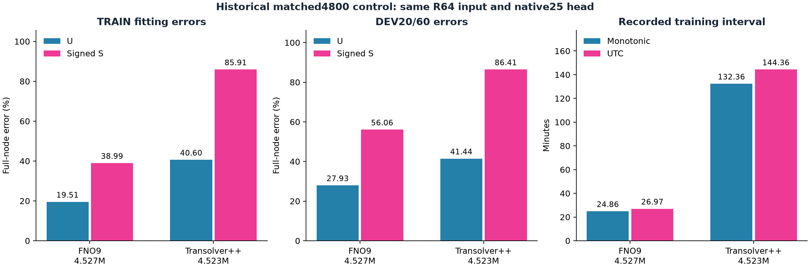

# Historical backbone and decoder selection

This archive recovers **historical** FNO, Transolver, Transolver++, Transolver3 and MLP measurements from the repository's Git history. It explains the choice of the FNO workhorse before the later displacement/gradient-input experiments. It is not a new backbone benchmark, final-set ranking or comparison against the latest Fieldwise model.

Historical names containing `PHYSICAL` mean **physical-unit U/S targets and loss**, not the later 12 predictor columns `[physical U3, 1000 × gradient9]`. None of the five groups below uses those physical covariates. Original CSV GRID alignment, signed U in mm and signed S in MPa are retained. Retracted H5-only results are excluded. The [five original historical reports](../research_history/README.md) are also retained unchanged, separately from this curated selection layer.

## Main selection evidence: TRAIN100, matched20 exposure

One seed (2026), 100 training CADs × three loads, 20 full-node passes (6,000 updates), and the same iterated DEV20 × three loads. Means are case-equal full-node relative L2 errors. FNO is a frozen earlier readout, not rerun with the two continued candidates.

| Package | U error | Signed S error | Mean primary | Parameters | 60-field inference UTC / monotonic |
|---|---:|---:|---:|---:|---:|
| FNO | 20.647% | 48.830% | 34.739% | 4,526,858 | 1.266 / 1.266 s |
| FNO + Hash decoder | 20.375% | 48.339% | 34.357% | 12,245,894 | 1.322 / 1.322 s |
| Original Transolver + Hash decoder | 35.793% | 59.381% | 47.587% | 9,601,208 | 6.501 / 3.546 s |

FNO has lower U/S errors and lower recorded inference time than this original-Transolver package. Hash has **slightly lower** errors than FNO in this single-seed screen; FNO is not the numerical winner of every comparison. The later [three-seed confirmation](../neural_baselines/README.md) gives FNO U/S 21.723% / 49.333% versus Hash 21.974% / 48.711%. Hash's primary advantage is 0.186 pp and its S advantage 0.621 pp, below the predeclared 3-pp practical-advantage criteria. This supports the smaller FNO as the default joint-field package, while retaining the Hash hotspot result.

Capacity and arithmetic differ: FNO is FP32; Hash uses native TCNN FP16 decoder arithmetic with FP32 master weights; the original TS operator uses BF16 with FP32 model/Adam and returned latent, plus TCNN. Matched exposure is not matched capacity, equal compute or a single-factor backbone cause. Inference excludes full engineering input production; timing isolation is not established. UTC and monotonic clocks are retained separately, without rescaling.

| Continued package | Added training interval UTC / monotonic | Meaning |
|---|---:|---|
| FNO + Hash | 259.697 / 239.003 s | Hash10→20, including intermediate readouts/saves |
| Original TS + Hash | 1,240.414 / 1,136.947 s | TS5→20, including intermediate readouts/saves |

These intervals start from different exposures and **are not cumulative or matched training costs**. Unknown costs are null in JSON and blank in CSV, not zero. FNO's separate archived 0→20 record reports 370.409 / 338.227 s training and 858.962 / 781.445 s corresponding stage cost; this different scope is not used to manufacture a training-speed ratio.

## Supporting control: common R64 input and query head

### Original matched4800 control

The original [common-grid BRIEF](../research_history/original_reports/results/geobc_common_grid_comparison/BRIEF.md), recovered from `e5a052535`, is the important representation/capacity control. It uses the same R64 input, PointNet, native25 query head, TRAIN40/120, 4,800 updates and known DEV20/60. Capacities are closely matched rather than numerically identical.

| Package | Parameters | TRAIN U / S | DEV U / S | Training UTC / monotonic minutes | Inference, monotonic |
|---|---:|---:|---:|---:|---:|
| FNO9 | 4,526,858 | 19.514% / 38.986% | 27.930% / 56.062% | 26.969 / 24.855 | 1.960 s |
| Transolver++ PP256 | 4,523,268 | 40.601% / 85.913% | 41.437% / 86.406% | 144.359 / 132.357 | 17.652 s |

Both fitting and development errors favor FNO in this control. The source table's old unequal-capacity FNO/PP references are not relabelled as matched arms. The original report separately excludes initialization, input IO, saving and whole-stage costs from model inference.

### Separate continued12000 endpoints

TRAIN40 × three loads, same R64 input, PointNet and native25 query head, approximately 4.53M parameters, one seed, 12,000-update endpoints (100 case passes), known DEV20/60 readout.

| Package | U error | Signed S error | Hotspot S error | 60-field inference, monotonic |
|---|---:|---:|---:|---:|
| FNO | 26.504% | 55.552% | 41.496% | 2.165 s |
| Transolver++ | 52.349% | 83.987% | 84.596% | 16.070 s |

This tighter input/head control also supports the tested FNO package, in a separate experiment from TRAIN100 matched20. The intended 24,000-update continuation was curtailed; no 24,000 endpoint is claimed complete. Interrupted cumulative training costs are not reconstructed here.

## Earlier family screen: five CADs, vertical load only

TRAIN40/120, 4,800 updates, one seed. All five CADs were unused in that training; two belong to the official TRAIN pool and three to TEST. U fields were already known; S was read after predictions. They are **not** current DEV20 or FINAL20. Representation and capacity vary substantially.

| Family | U error | Signed S error | Parameters | Historical training minutes |
|---|---:|---:|---:|---:|
| FNO | 20.621% | 55.062% | 14,177,284 | 20.106 |
| Transolver | 28.021% | 81.075% | 1,851,692 | 23.337 |
| Transolver++ | 25.913% | 74.461% | 4,492,788 | 68.546 |
| Transolver3 | 29.185% | 82.955% | 7,645,156 | 73.374 |
| MLP | 30.862% | 73.556% | 230,756 | 9.835 |

MLP is cheaper; FNO offers better measured U/S accuracy. Training minutes use historical `train_seconds`, excluding initialization/checkpoint/readout, rather than full campaign cost. This pilot cannot establish a universal architecture ranking.

## Negative representation diagnostic: TRAIN only

Native-node original TS did not improve sufficiently over its R64-context counterpart at matched10 exposure: TRAIN300 U/S approximately 43.25% / 55.23% versus 43.20% / 54.77%. The predeclared continuation criterion failed. No new DEV or FINAL was read; this closes the representation branch, not the Transolver family. Both rows are retained separately in the exported data.

## Separation from latest physical enhancement

| Evidence | Question | Report |
|---|---|---|
| Historical backbone/package screens | Suitable U/S accuracy, capacity and cost trade-off? | This archive; [three-seed decoder confirmation](../neural_baselines/README.md) |
| Matched physical inputs | Do U and recovered-gradient predictors help? | [ZERO versus ACTUAL](../physical_information_learning/README.md) |
| Input-group ablation | Which fields benefit from U3 or gradient9? | [Input components](../input_components/README.md) |
| Compact field-specific model | Can a shared FNO retain field-specific benefits? | [Shared-trunk Fieldwise](../shared_trunk_field_learning/README.md) |
| Frozen final evaluation | Does the selected hybrid improve on its ZERO control? | [Final results](../final_evaluation/README.md) |

Ablations motivate Fieldwise under this protocol, without proving universal necessity or a sole gradient-conflict mechanism. The latest three-seed enhanced model was **not** compared with freshly retrained Transolver variants on FINAL20. Do not combine these groups into a supposedly matched leaderboard. Development is iterated and availability-conditional; three seeds share 20 CADs, not 60 independent CADs.

## Files and provenance

- `summary.csv`: 14 aggregates across five groups, with split, exposure, capacity, precision and cost scope.
- `per_case.csv`: 1,045 saved scalar rows, including separately labelled TRAIN diagnostics.
- `metrics.json`: compact scientific metadata; no weights, arrays, prompts, chat history or execution receipts.
- `comparison.png`: historical TRAIN100 matched20 accuracy and inference cost.
- `common_grid_control.png`: the original matched4800 fitting/development results and recorded training intervals.

Most later source reports were recovered from ordinary Git revision `0277577`; the original matched4800 control is from the explicitly requested `e5a052535`:

- [Early family screen](https://github.com/baiming-zhang/GeoBC-Neural-Operator/blob/0277577/results/geobc_fixed4800_pilot/metrics.json)
- [Original common-grid control](https://github.com/baiming-zhang/GeoBC-Neural-Operator/blob/e5a052535/results/geobc_common_grid_comparison/metrics.json)
- [Common-input control](https://github.com/baiming-zhang/GeoBC-Neural-Operator/blob/0277577/results/geobc_short_screen/metrics.json)
- [Matched20 development readout](https://github.com/baiming-zhang/GeoBC-Neural-Operator/blob/0277577/results/geobc_matched20_readout_v79/metrics.json)
- [Native-context TRAIN diagnostic](https://github.com/baiming-zhang/GeoBC-Neural-Operator/blob/0277577/results/geobc_nativeTS100_matched10_v80/metrics.json)

Rebuild with `python -B -m tools.export_backbone_comparison`. It also restores the five requested original reports into the separate history archive. Only saved reports/scalars are read; no training, model inference or ground-truth body is reopened.
