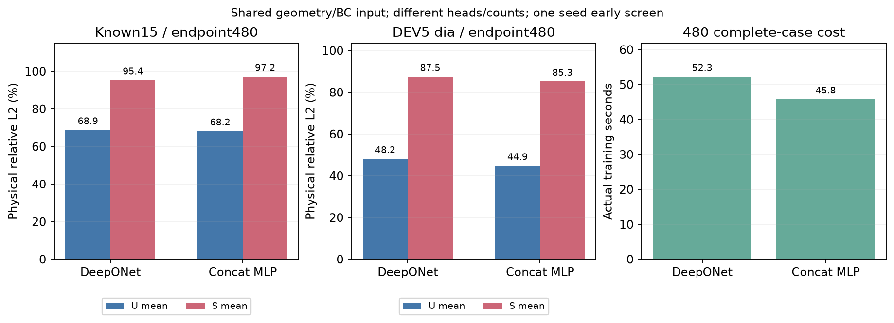

# GeometryBC DeepONet 结构初筛

两个fresh模式共同BC22→global32、力无关u9与独立非线性signed stress头。固定seed2026/480完整案例更新/四pass；U为全原节点mm向量，S为MPa源signed scalar。

| known15 / endpoint480 | U mean / worst % | S mean / worst / hotspot % | actual训练秒 |
|---|---:|---:|---:|
| DeepONet | 68.86 / 99.24 | 95.36 / 99.98 / 98.10 | 52.29 |
| Concat MLP | 68.24 / 96.74 | 97.18 / 99.57 / 98.56 | 45.81 |

DeepONet相对concat：U/S均值改善 -0.61/+1.82pp；最差U/S恶化 +2.49/+0.41pp。正改善为误差降低，正恶化为变差；不预设赢家。
共同recipe/scaler/案例与节点曝光、首实际梯度/单位收据：PASS；不是full-model初始化或容量匹配。

| DEV5 dia / 两个480端点 | U mean / worst % | S mean / worst / hotspot % |
|---|---:|---:|
| DeepONet | 48.22 / 59.21 | 87.55 / 90.07 / 95.86 |
| Concat MLP | 44.87 / 61.43 | 85.30 / 88.42 / 94.78 |

历史同480 known15 U/S mean（非matched）：FNO force-free u9 35.03/76.97%；FNO retained-load u9 35.94/76.98%；FNO direct4 47.51/66.71%；MLP direct4 71.59/97.60%。输入/架构/容量不同，不能作同成本因果结论。

45CAD BC cloud保持真实原索引与精确坐标、零target/weights读取；0/45 CAD采样漏已有角色，按原样保留。共同encoder初始化仅声明同constructor/seed；full heads/容量不同。

全节点曝光、首真正梯度/ctx一次反传、μ一次偏移/α/零载荷见证、参数/显存、wall/推断/共享准备秒与每case最差ID见[metrics.json](metrics.json)。计时可能重叠，不相加；应力不假设标量叠加。单seed早期结构诊断，不是工程资格/GT线性/连续BC证明。旧final与新sealed test未读取，不据dia选seed/best或调参。

