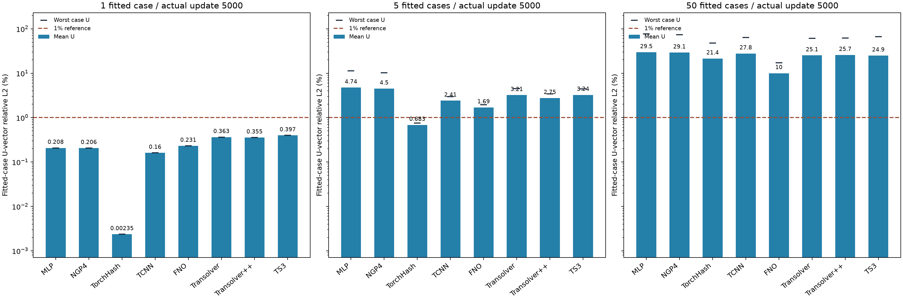
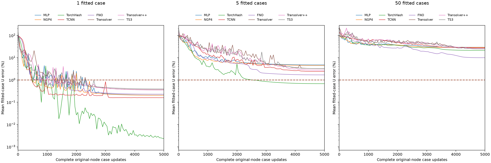

# 1 / 5 / 50 样本：全部8方法U-only，统一完整5000步

历史记录：其中TCNN为原生FP16。最新TCNN单/五/50三项已改为原生FP32并完整重训5000步；[最新24项比较](../tcnn_fp32_u_overfitting/README.md)保留其他21项端点。

新50样本阶段于北京时间2026-10-17T02:10:09.894669+08:00结束，8项均为实际第5000次完整原节点更新的端点。已有1/5样本16项5000步标量原样保留；不重训或重新读出历史模型/GT，不挑best。

50个不同CAD，每CAD一个载荷，固定包含原来的5个案例。先保留5锚点，再按现有归档顺序选剩余TRAIN40案例，最后按ID顺序补8个additionalTRAIN60 CAD，载荷ver/hor/tor循环。名单在读数值标签之前固定；未使用DEV、test或FINAL。完整名单见[配置](../../configs/fifty_u_samples.json)。

全部组同seed2026、约460万±1%实际注册/活跃参数、同结构和28通道输入(normalizedXYZ+25原条件)、3通道signed Uxyz(mm)、仅U-vector relativeL2平方损失。Adam betas(.9,.999)、eps1e-8、weight_decay0、fused；梯度L2clip1；OneCycle总5000、pct_start.1、cos两阶段、div25/finaldiv1000、cycle_momentumFalse。第1次实际LR4e-5、第500峰值1e-3、第5000次4e-8。所有方法统一，无早停，无1%提前退出。

一次更新覆盖一个CAD×载荷的全部原节点，固定循环。5000更新对应单样本5000遍、五样本各1000遍、50样本各100遍；这是相同更新预算，不能当作相同每样本训练遍数。每50步完整评价全组，50样本评价开销更高；组内U输出RMS仅用对应拟合样本，损失仍逐case相对能量归一化。

原阶段50个训练case在GPU共享缓存中各加载一次，所有8方法共享；42个来自已对齐NPZ，8个来自既有对齐TRAIN NPY。后者仅复制interleaved physical.npy的前三列U，不使用第四列S。无sampleID、physicalU、teacher、stress或heldout输入。避免无用途的best模型/预测写盘；每次评价与最终全状态last.pt、四RNG、Adam/scheduler、order/cursor、实际成本、50份端点预测均保留本地。恢复阶段的额外读取、CPU缓存和实际成本另列。

FP32/TF32，TCNN原生FP16/FP32master；++保留官方eval随机Gumbel单次读出。统一训练配方不等于数学完全公平；这是单seed训练集拟合比较，不是泛化测试或架构上限。50样本量和载荷组成也发生变化。

|方法|1样本U%|5样本均值%|5样本最差%|50样本均值%|50样本最差%|各项步数|
|---|---:|---:|---:|---:|---:|---:|
|MLP|0.2075|4.7428|11.3329|29.5333|77.0690|5000|
|NGP4|0.2057|4.4985|10.1729|29.1136|73.1583|5000|
|TorchHash|0.0024|0.6831|0.7506|21.3929|47.5205|5000|
|TCNN|0.1602|2.4054|2.9744|27.7953|63.5444|5000|
|FNO|0.2305|1.6939|1.9405|9.9989|17.0790|5000|
|Transolver|0.3628|3.2076|4.4722|25.1500|61.4277|5000|
|Transolver++|0.3549|2.7529|3.4265|25.6559|62.0583|5000|
|TS3|0.3971|3.2396|4.4200|24.9284|66.2128|5000|

50样本组有0/8方法的所有案例均U<1%。本表保留实际5000端点，即使某方法比小样本或旧中间值更差也不替换。

新50样本任务完整计算阶段成本15030.74s UTC / 14743.00s单调时钟，包含导入、缓存、模型构造、训练、评价、存盘和退出；预算未延长。source case读取100次、stress数值列/heldout读取0。已有1/5完整交付阶段成本14412.99s UTC / 14202.69s单调时钟单列，包含其早停废弃工作；本次未重算。导出只读标量，模型/GT/科学数组读取0。

[新增8项](summary.csv) · [新增400个逐样本端点](per_case.csv) · [全部24项](all_methods.csv) · [全部448行逐样本](all_per_case.csv) · [学习曲线标量](learning_curves.csv) · [历史1/5报告](../fullcycle_u_overfitting/README.md)

Transolver++在完成21次更新后、下一次更新开始前触发30.5GB显存上限。其余7项完成后，原model/Adam/OneCycle/四RNG/order/cursor从保存的21步状态接续4979步，无零模型重放、无额外读出改变RNG。只将共享数据缓存移到CPU，逐完整案例转入GPU并释放allocator缓存；结构、精度、损失、样本顺序、LR与梯度裁剪不变。恢复仍受原whole截止时间及保守的原++起点+10800秒双时钟截止约束，等待也消耗原arm余量。恢复额外共享读取50个TRAIN案例，总100次；等待与原TS3重叠，不重复计成本。恢复前后实际成本均包含于上文，分项见metrics.json。

## 标量结果解释

在当前5000次更新预算下，FNO的50样本均值9.9989%、最差17.0790%，在这8个实现中均最低；TorchHash为21.3929%/47.5205%，其余均值约24.93%–29.53%。400个新增逐样本端点中，没有任何一个U<1%；八个单样本端点全部<1%，五样本仍仅TorchHash全案例通过。这是当前配方和名单的拟合结果，不是普遍架构排名。

仅比较原先相同的五个案例，50样本模型的误差也全部高于原五样本模型，说明整体均值升高并不只是因为新加入案例更难。下表完全从已导出的逐案例标量筛选，没有额外模型推理或GT读取。

|方法|原五样本模型：五案例均值U%|50样本模型：相同五案例均值U%|50样本模型：相同五案例最差U%|
|---|---:|---:|---:|
|MLP|4.7428|33.1874|65.9248|
|NGP4|4.4985|32.2851|64.9996|
|TorchHash|0.6831|22.5526|36.3971|
|TCNN|2.4054|25.7913|40.4064|
|FNO|1.6939|9.6319|16.2158|
|Transolver|3.2076|21.0042|61.4277|
|Transolver++|2.7529|21.9663|62.0583|
|TS3|3.2396|22.4584|66.2128|

解释时需同时考虑：每样本只更新100遍，而五样本为1000遍；拟合几何和载荷组成、组内RMS输出尺度也改变。该实验没有控制每样本训练遍数、只增加数据量的单因素对照，不能将误差差异单独归因于容量不足或代码错误，也不能声称这已是收敛上限。

末1000步的平均U误差仍有变化：FNO从12.5870%降到9.9989%，Transolver从29.9956%降到25.1500%，++从30.0088%降到25.6559%，TS3从28.2545%降到24.9284%；MLP/NGP4端点则略高于4000步。没有用更好的中间值替换5000步。学习率末段趋零带来的曲线变平不足以证明架构瓶颈；++还保留官方随机Gumbel评价。

50案例载荷构成为ver15、hor13、dia9、tor13，不应把各载荷案例看作完全同难度。提供[按载荷标量](per_load.csv)、[50案例误差分布与末段数值](error_distribution.csv)和[共同五案例比较](same_five_cases.csv)供追查，未追加训练或读取科学数组。
