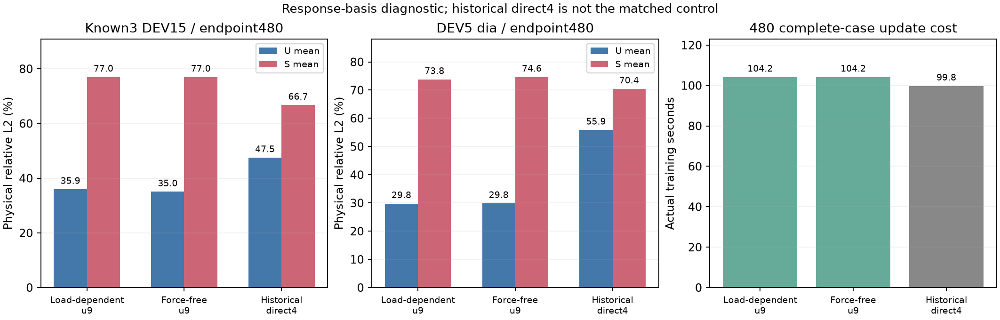

# FNO 响应基结构诊断

固定seed2026、480完整案例更新/四passes；两fresh u9 arm为配对，历史direct4仅上下文。U为signed XYZ向量、S为源signed scalar，均在全原节点物理单位上评估。

| known3 DEV15 / 固定480 | U mean / worst % | S mean / worst / hotspot % | actual训练秒 |
|---|---:|---:|---:|
| 保留载荷u9（control） | 35.94 / 60.10 | 76.98 / 90.68 / 83.74 | 104.18 |
| 力无关u9（candidate） | 35.03 / 60.17 | 76.97 / 90.95 / 83.80 | 104.18 |
| 历史direct4（非matched） | 47.51 / 71.86 | 66.71 / 78.73 / 65.11 | 99.78 |

候选相对fresh control：U均值改善 +0.91pp、S均值改善 +0.01pp；最差U/S恶化 +0.07/+0.27pp（正值为变差）。实值逐项报告，未自动判赢家。
共同recipe/输入/scaler、案例顺序、参数布局及首实际梯度/单位见证：PASS。两臂声明同constructor/seed，未保存完整初始参数哈希；不能把该声明当全tensor比对。zero-load均值偏移/α/query见证原样保存在metrics.json。

| 独立DEV5 dia / 同endpoint480 | U mean / worst % | S mean / worst / hotspot % |
|---|---:|---:|
| 保留载荷u9（control） | 29.77 / 38.74 | 73.80 / 77.90 / 86.27 |
| 力无关u9（candidate） | 29.84 / 39.94 | 74.63 / 78.49 / 87.03 |
| 历史direct4（非matched） | 55.86 / 64.04 | 70.44 / 75.32 / 82.90 |

训练节点曝光、参数、wall/累计推断秒、独立input-guard成本、每case绝对mm/MPa误差与最差ID见[metrics.json](metrics.json)；计时有重叠，不能相加。stress独立非线性分支，不声称标量应力叠加；位移载荷线性是结构假设，不能当GT线性或工程合格证明。单seed四passes；DEV已被探索，旧final与新sealed test未读取，未据结果扩预算/调loss。

