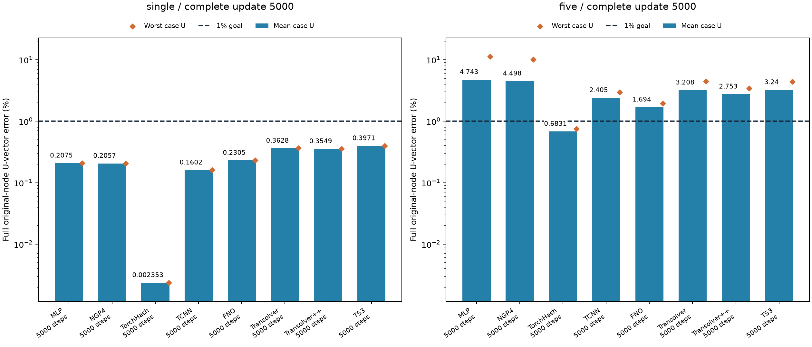
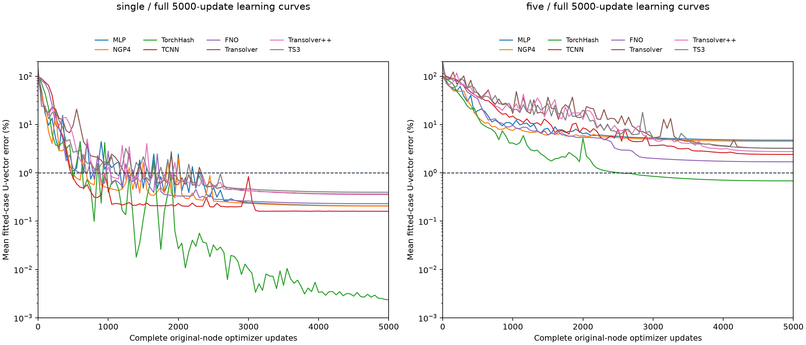

# 单/五样本全部8方法U-only：统一OneCycle，全部完整5000步

**新增50样本后的最新完整对照见[1/5/50样本比较](../fifty_u_overfitting/README.md)**。本页16个5000步端点和全部历史成本原样保留；新增50个不同TRAIN CAD的8项均满5000步，每案例100遍，使用相同优化配方。50样本结果不替换本页原单/五样本值。

北京时间2026-10-16T15:57:41.311002+08:00完成。最终16项每项实际更新5000次，均使用第5000步完整原节点端点。已跑满项目保留；所有早停项目按用户要求从seed2026重新初始化、关闭早停重跑。旧早停值和中间误差不替代主表，不选best checkpoint。

所有方法统一Adam betas(.9,.999)、eps1e-8、weight_decay0；每次optimizer后调用OneCycleLR，total_steps5000、pct_start0.1、cos两阶段、cycle_momentumFalse、div_factor25、final_div_factor1000。第1步4e-5、第500步峰值1e-3、第5000步4e-8；全参数梯度L2裁剪1，完整评价每50步。各方法沿用自身原结构，重跑前后样本顺序、输入、U-only损失和seed不变。OneCycle按步数调度，不是根据loss寻找LR。

早停原轮最早1500步、以最差样本历史最优600步未改善作停止规则，截断了部分项目的低学习率阶段。例如五样本MLP在1550步、LR8.72e-4停止，但均值误差仍从950步11.02%改善到6.50%；NGP4在2150步、LR7.03e-4停止，2100步均值5.70%。这些不是充分收敛或架构瓶颈的证据。因此全部提前停止项重跑，已完整5000步项不做无效重算；重跑只移除停止判断，优化配方相同。

一次更新完整一CAD×载荷全部原节点；single506_533/ver共5000遍；five加506_25/tor、10_30/ver、10_421/hor、10_460/dia各1000遍。signed Ux/Uy/Uz(mm)，U-vector relativeL2平方损失；归一化XYZ+25原条件，无sampleID、物理U、teacher、应力或heldout输入。输出RMS仅拟合样本。实际注册和full-node有限梯度参与参数均460万±1%。++保留原生未参与无条件分支embedding，活跃数单列。

FP32/TF32；TCNN原生FP16/FP32master；++保留官方eval随机Gumbel单次读出。训练参数一致不意味着数学完全公平、架构上限或泛化排名。小于1%的验收要求每个完整样本，而不是均值。

原统一轮成本13527.50s UTC / 13347.03s单调时钟；新重跑阶段885.49s / 855.66s。合计14412.99s / 14202.69s，包含旧早停已用成本、导入、缓存、构造、训练、评价、保存和退出，非仅选中模型的训练耗时。每阶段5TRAIN NPZ共享各读一次，两阶段合计10次；stress/heldout读取0。等待队列与原阶段重叠，不重复累加。更早被用户改配方中断的3000步轮758.16s UTC/696.08s单调时钟独立保留，不冒充技术恢复。两个阶段退出码均0、预算未延长。完整预测和model/Adam/scheduler/四RNG/order/cursor/clock留本地；导出仅访问标量，科学数组读取0。

|方法|单样本U%|五样本U均值%|五样本最差U%|单/五步数|
|---|---:|---:|---:|---:|
|MLP|0.2075|4.7428|11.3329|5000 / 5000|
|NGP4|0.2057|4.4985|10.1729|5000 / 5000|
|TorchHash|0.0024|0.6831|0.7506|5000 / 5000|
|TCNN|0.1602|2.4054|2.9744|5000 / 5000|
|FNO|0.2305|1.6939|1.9405|5000 / 5000|
|Transolver|0.3628|3.2076|4.4722|5000 / 5000|
|Transolver++|0.3549|2.7529|3.4265|5000 / 5000|
|TS3|0.3971|3.2396|4.4200|5000 / 5000|

## 结果解释

完整5000步端点：单样本8/8方法通过U<1%，五样本1/8方法达到每样本U<1%。TorchHash五样本均值0.6831%、最差0.7506%；本轮其余五样本方法均未全部通过。该结论只覆盖当前单seed、5个拟合CAD×载荷及这套训练配方。

MLP五样本：早停均值6.4991% → 完整5000步4.7428%（相对下降27.02%），最差16.0091% → 11.3329%。低学习率尾段确实改变了结论，不能把旧早停值当作拟合瓶颈；完整5000步后仍未每样本达1%。
NGP4五样本：早停均值6.2942% → 完整5000步4.4985%（相对下降28.53%），最差14.0709% → 10.1729%。低学习率尾段确实改变了结论，不能把旧早停值当作拟合瓶颈；完整5000步后仍未每样本达1%。

MLP五样本的主要残差集中于506_533/ver（11.3329%）和10_30/ver（9.6809%），其余三个案例均<1%；NGP4相同两个ver案例为10.1729%/8.6820%，另三个为约1.11%–1.40%。这是误差分布观察，尚未验证其机制，不能直接归因于参数量或几何输入。

更多更新不保证端点单调变好：TCNN单样本早停0.1340% → 完整5000步0.1602%。主表按要求保留后者，不挑选更好的旧端点。

Transolver系列本轮单样本全部<1%，与此前1000步配方的失败不同；但步数、学习率过程及峰值共同改变，不能把改善归因于单一因素。即使末段曲线变平，本轮也只证明5000步后的实际表现，不能证明架构上限或独立泛化能力。

## 端点来源

|组|方法|实际步数|活跃参数|来源|全样本U<1%|
|---|---|---:|---:|---|---|
|five|FNO|5000|4601006|保留原轮完整5000|否|
|five|TorchHash|5000|4597251|保留原轮完整5000|是|
|five|MLP|5000|4596595|关闭早停后fresh重跑|否|
|five|NGP4|5000|4615555|关闭早停后fresh重跑|否|
|five|TCNN|5000|4597120|保留原轮完整5000|否|
|five|Transolver|5000|4586786|保留原轮完整5000|否|
|five|Transolver++|5000|4609512|保留原轮完整5000|否|
|five|TS3|5000|4562379|保留原轮完整5000|否|
|single|FNO|5000|4601006|保留原轮完整5000|是|
|single|TorchHash|5000|4597251|关闭早停后fresh重跑|是|
|single|MLP|5000|4596595|保留原轮完整5000|是|
|single|NGP4|5000|4615555|保留原轮完整5000|是|
|single|TCNN|5000|4597120|关闭早停后fresh重跑|是|
|single|Transolver|5000|4586786|保留原轮完整5000|是|
|single|Transolver++|5000|4609512|保留原轮完整5000|是|
|single|TS3|5000|4562379|保留原轮完整5000|是|

[16项汇总](summary.csv) · [48行逐样本](per_case.csv) · [学习曲线标量](learning_curves.csv) · [配置与实际成本](metrics.json)

此前[固定1000步对照](../matched_capacity_u_overfitting/README.md)与[Transolver1000步调整](../stabilized_u_overfitting/README.md)作为历史独立保留。
