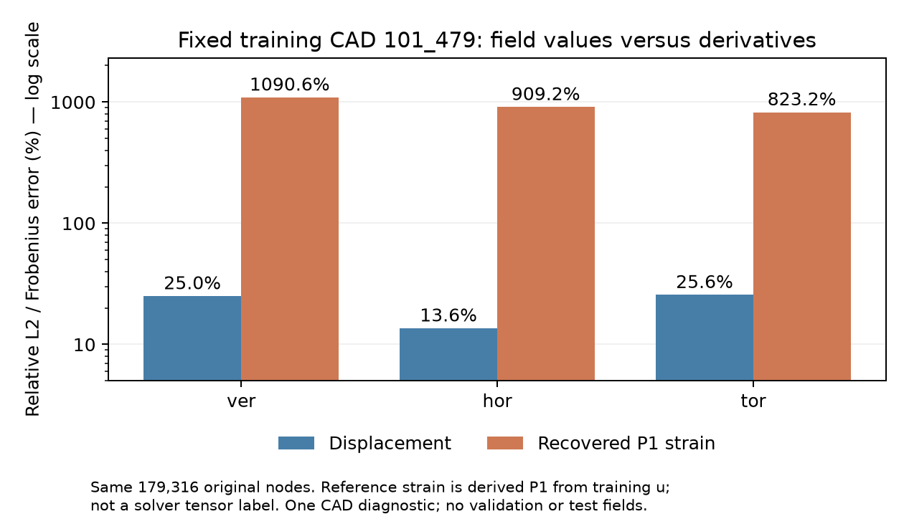
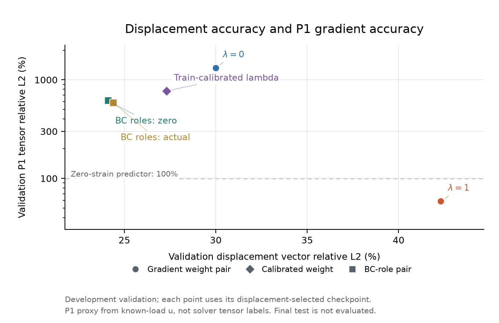
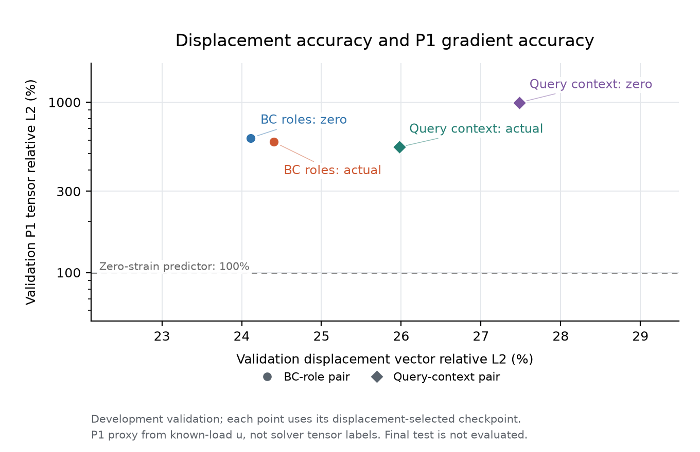
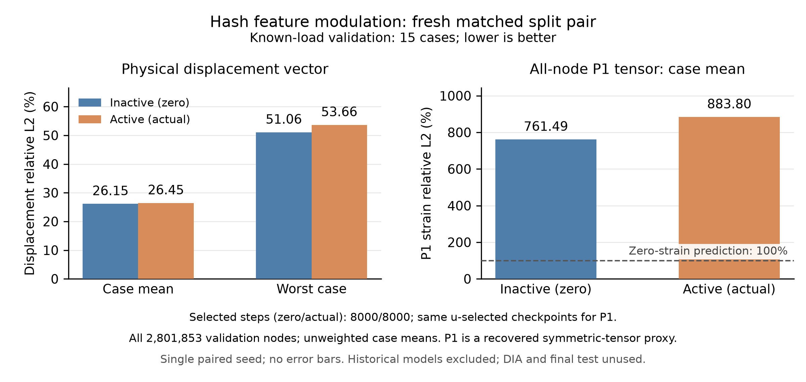
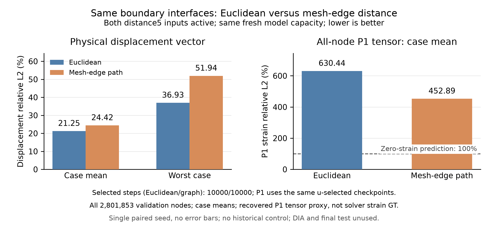

# GeoBC 探索：当前结论与下一步

研究对象：原版 DeepJEB；使用逐节点坐标对齐的原始有符号应力。原30项slides复现已完成，本页的后续自主研究仍在继续。

## 当前结论

**完整GeoBC的求解器尚未选定；先比较准确率、成本和几何／载荷迁移，停止Hash专项微调。**

当前凝练结论见 [一分钟判断](../SOLVER_BRIEF.md)；十类学习结构和物理候选已有阶段结果。下文保留此前Hash探索证据，不代表跨求解器排名。

- 原共享模型训练集平均应力 L2：16.167%。
- 两个未参与该模型训练的 CAD：平均 92.133%。
- 三个已见 CAD 的九个新载荷组合：平均 92.875%。

| 案例 | 原共享模型 | 独立拟合 |
|---|---:|---:|
| 101_479/tor | 28.967% | 0.067% |
| 107_320/tor | 28.126% | 0.125% |
| 114_202/tor | 25.518% | 0.055% |

这些对照固定了架构、输入和父模型 scaler；独立模型增加了总容量，不能单独证明某个几何模块必需。

## 几何条件能否改善泛化

使用同一 40-CAD 训练／5-CAD 验证划分。每组对照的 decoder 布局、随机采样、预算相同；scaler 只拟合训练标签。每项训练10,000次更新，不能与原50案例的1000个完整epoch直接等同。
训练与选模型只使用 ver/hor/tor；五个官方测试 CAD 保持隔离。验证CAD的dia曾作一次模型冻结后的诊断，后续不能再称全新盲测。

| 同配置对照 | 零几何特征：验证误差 | 实际几何特征：验证误差 |
|---|---:|---:|
| 整体几何／宽度64 | 65.467% | 65.437% |
| 整体几何／宽度128 | 65.261% | 65.279% |
| 局部几何／宽度128，均有PointNet | 65.292% | 63.598% |
| 局部几何／同配置，种子2027 | 64.856% | 64.043% |

整体PointNet的收益不足0.04个百分点，加宽解码器后最佳验证误差仍约65.3%；目前不能认为这些改动改善了泛化。
局部几何对照使用13维离散边界距离、方向和邻域形状特征；只从几何构造，无标签拟合。同组零特征模型保留相同输入槽与参数布局。
首个种子的局部特征收益为1.69个百分点；第二个种子用于检查收益是否稳定，高误差仍未解决。
第二个种子的收益为0.81个百分点。两次均改善平均与热点误差，但最差案例变差；不能称为全面改善。

## 位移的载荷响应基

已实现ver/hor/tor位移响应的线性组合，并与同容量、允许响应基依赖载荷的控制模型比较。几何输入、训练预算和随机采样保持相同。
45个训练/验证CAD的求解配置支持该设定；源FEM叠加残差见下方冻结诊断。训练只拟合原始uXYZ，使用训练集的零中心线性尺度；应力保留独立监督。

| 位移响应基 | 最佳点训练误差 | 验证误差 |
|---|---:|---:|
| 载荷无关，强制线性 | 21.297% | 30.584% |
| 载荷依赖控制 | 17.462% | 30.080% |

训练集证据：相同相对误差下，扭转载荷仅占原共同RMS损失约1.3%的权重。改为训练案例RMS归一化损失，物理解码尺度保持不变：
- 线性响应基：验证平均29.178%，最差54.962%。
- 载荷依赖对照：验证平均29.086%，最差56.269%。
训练扭转拟合明显改善，但验证平均收益小、最差案例变差，幅值权重不是全部泛化瓶颈。

冻结后仅评估五个验证CAD的dia组合（933,951个原节点）：
- 位移平均误差：线性响应基28.412%，载荷依赖对照32.993%。
- 源FEM位移叠加残差平均0.306%，支持近似线性；不能说数值残差为零或已确定其来源。
- 独立应力模型的dia平均误差仍为87.426%，组合载荷应力预测仍是主要瓶颈。
这是验证集载荷组合诊断，未读取最终测试CAD。线性模型的最大绝对位移误差仍可能高于对照，完整物理指标保留在原始summary。

## 冻结预测位移作为应力条件

按常规载荷验证均值选择并冻结案例归一化损失的线性位移教师（29.178%）。每CAD只推断一次三组响应，再按当前载荷组合成三维预测位移；应力模型的对应三个槽使用预测值或全零。两者均从头训练，相同41维局部输入、32维整体描述、采样与10k预算。
预测条件生成不读取真实位移或应力；教师本身使用额外的训练位移监督，因此整个pipeline不能声称与stress-only模型有相同监督量或总成本。两个候选教师训练成本合计约223秒，缓存生成和应力训练成本另列。

| 位移条件 | 验证应力均值 | 最差案例 | 热点均值 | 训练耗时 |
|---|---:|---:|---:|---:|
| 零槽 | 64.497% | 82.331% | 38.896% | 85.6s |
| 冻结预测位移 | 62.692% | 75.410% | 43.651% | 81.7s |
位移条件改善了均值与最差案例，但热点变差；未通过预定的复验门。下一轮固定预测u3，比较廉价mesh恢复应变六槽与同布局全零槽，检验局部变形变化是否提供不同的信息。它是corner-P1离散代理，不是精确TETRA10应变，也不以本构公式替换源应力标签。

## 固定预测位移，增加局部应变条件

双方保持同一预测u3、几何、应力loss、采样和预算。TETRA10前四角点计算cell常梯度，以体积向原十节点平均；六个tensor应变分量只使用训练CAD预测应变的共同零中心RMS缩放。47维局部条件加32维整体描述，zero/actual布局和初始化匹配。该代理忽略二次单元内应变变化。

| 应变条件 | 验证应力均值 | 最差案例 | 热点均值 | 训练耗时 |
|---|---:|---:|---:|---:|
| 零槽 | 62.112% | 74.829% | 43.134% | 89.6s |
| 预测P1应变 | 62.780% | 74.871% | 42.299% | 87.1s |

## 节点位移准确，不等于局部梯度准确

固定训练CAD101_479的三载荷平均位移误差为21.403%，由相同corner-P1算子恢复的tensor应变误差为940.988%，约为位移相对误差的44.0倍。预测应变量级为参考的约9–11倍。CPU诊断耗时0.77s，没有读取应力、验证、dia或最终测试字段。
这支持当前冻结教师的导数质量不足，不能把应变条件无整体收益解释成应变信息无用。参考应变由已有训练u派生，是四角点P1代理，不是solver输出的真应变张量。结论目前仅限该固定训练CAD。

下一组保持原载荷线性位移模型，两侧使用相同的节点/单元角点混合采样与51,200次前向查询，仅比较是否增加训练u派生的体积加权P1梯度监督。选checkpoint仍只看已知载荷验证位移均值；最终测试及dia继续隔离。设计与后续判据提前保存于notes/geobc_gradient_teacher_plan.json。
函数值与导数共同监督已有 [Sobolev Training](https://papers.nips.cc/paper_files/paper/2017/hash/758a06618c69880a6cee5314ee42d52f-Abstract.html) 工作。本实验使用位移派生的离散P1应变目标，验证其对GeoBC教师及跨CAD迁移的作用；加入梯度损失本身尚不构成新算法结论。
同一训练CAD的真实u按冻结教师共同尺度做FP16往返舍入，u误差为0.021%、恢复应变误差为2.371%。这远不足解释当前约941%的应变误差；这是oracle舍入敏感性诊断，不是严格误差下界或因果分解，也不能排除内部算术等其他因素。

## 匹配的位移梯度监督

两侧使用同一load-linear模型、训练u共同尺度、相同混合节点/角点查询和初始化。相较历史教师，两侧共同将一半查询改为均匀单元的角点；内部对照仅改变梯度目标的系数0或1。梯度参考来自训练u，按单元体积及完整训练案例Frobenius能量归一化，验证目标不拟合损失权重。各checkpoint仍只由验证位移均值选择。

| 梯度损失 | 验证位移均值 | 验证位移最差 | 验证P1应变均值 | 训练耗时 |
|---|---:|---:|---:|---:|
| 系数0 | 29.991% | 49.492% | 1319.086% | 163.5s |
| 系数1 | 42.308% | 66.705% | 58.591% | 205.7s |
在同一u-selected checkpoint，验证应变误差相对减少95.6%，固定训练101_479减少91.2%；验证位移均值变差12.32个百分点、最差变差17.21个百分点。预定后续判据未通过。
随后检查已导出的匹配代表案例是否有支撑边界整体位移偏移。只用预测u在已知零位移约束处的均值来计算偏移，真实u用于评价；常量平移不改变应变。这是选定代表的CPU诊断，完整验证与后续模型变更另行声明。

## 边界均值与刚体偏移的代表诊断

将预测位移在原SPC节点上的分量均值归零，两个已保存验证代表的位移误差为107_91/hor：15.639% → 16.407%；102_249/tor：66.705% → 66.390%。训练代表有改善，但验证没有一致收益；未扩为全45CAD校正。CPU耗时0.87s，常量偏移保持P1梯度不变。GT只用于指标，未用GT误差计算偏移；零均值也不等于逐节点严格满足Dirichlet约束。
后续固定一个训练历史校准系数：取零梯度基线step6000–10000五个既定训练minibatch的Lu/裸Lstrain中位数，得到0.000410665；没有验证调权重或额外乘数。独立入口仅改变scope/parser，计算函数与原版本逐函数AST及文本相同，原零控制复用。它是一次loss尺度控制，不是最优权重或参数梯度平衡。

固定训练系数结果：验证位移均值27.316%，最差54.438%，P1应变均值772.257%；u-selected step8000，耗时204.1s。配对控制与预定判据见notes/geobc_gradient_calibrated_result.json。
均值有改善，但最差位移误差退步4.95个百分点，预定综合标准未通过；P1误差仍高于预测全零应变的100%基准。因此没有进入第二种子或应力教师阶段，也没有继续扫损失权重。

## 整体边界角色条件对照

元数据核验确认原25通道已包含L_mm/200；45CAD尺寸仅178.10–185.28mm，暂缓显式尺寸缩放。这一对照之前PointNet只汇聚坐标；新对照在相同1024点云附加固定节点并集和加载节点两个输入角色。零角色与真实角色都采用5输入PointNet，新增64参数在两侧相同，不能复用旧3输入模型作控制。
保持既定位移／梯度损失、采样和预算，以新的零角色模型为基线比较全节点物理位移及P1代理应变。最差案例保护与不超过全零应变100%基准的门槛已预定；未通过时不自动增加种子或扫参数。设计见notes/geobc_bc_role_plan.json。

| 整体BC角色 | 验证位移均值 | 验证P1应变均值 | 训练耗时 |
|---|---:|---:|---:|
| 零角色 | 24.110% | 616.096% | 203.9s |
| 真实角色 | 24.403% | 583.883% | 213.5s |
匹配控制通过。真实角色使验证位移均值改善-0.29个百分点，最差位移变化-8.36个百分点（正数为退步）；P1误差相对改善5.2%。预定综合门槛未通过。
同一u-selected checkpoint的训练位移均值改善1.04个百分点；训练P1误差相对改善12.9%。该结果限已反复使用的开发验证，不是最终盲测。

图中每点均取该模型按位移验证均值选择的同一checkpoint；同形状标记区分各组对照。BC增益仅比较两个新方块，不能把旧三输入校准点与新五输入零角色点的差异归于BC信息。

## 固定训练CAD独立拟合

固定已观察的TRAIN101_479/ver、hor、tor，采用原xyz3模型与同一校准损失，共享模型的scaler和案例权重不重拟合。报告固定250与10000步，不用验证或应变挑选最优checkpoint。主要比较共享模型固定10000步的该CAD：位移16.85%、P1应变293.24%。
单CAD每步四个载荷槽有放回抽样，这是显式诊断变化。250步仅匹配共享10000步的期望案例曝光，完整10000步约有40倍曝光；独立模型也增加总参数。即使独立拟合成功，也不能单独证明共享容量不足或获得泛化能力。设计见notes/geobc_specialist_plan.json。

| TRAIN101_479三个载荷 | 位移均值 | P1应变均值 |
|---|---:|---:|
| 共享模型固定10000步 | 16.846% | 293.242% |
| 独立模型固定250步 | 7.473% | 136.578% |
| 独立模型固定10000步 | 0.757% | 17.889% |

独立训练耗时104.0s，最终最差位移0.868%、最差P120.850%。同一场与损失在该CAD能联合拟合；250步案例曝光接近共享10000步仍有改善，但优化轨迹与专用容量不同，不能单独证明共享容量或编码是原因。
后续回到40/5共享训练，匹配新增查询上下文32的零／真实分支：对同一PointNet几何／BC点token按固定Gaussian距离加权，σ=.15归一化长度。原全局32保留，新增投影和native输入容量在两侧相同；这是整个分支消融，不能称纯信息因果控制。设计见notes/geobc_query_context_plan.json。

## 查询位置相关几何与BC上下文

同一五通道PointNet的64维点token经共同64→32投影，再按查询点距离以固定σ=.15的Gaussian权重汇聚；保留整体32维描述和原38维查询输入。两侧拥有相同新投影、native条件102、初始化和训练配方，零组在计算后将查询上下文置零。旧BC模型不能充当该分支的匹配控制。

| 查询上下文 | 验证位移均值 | 最差位移 | 验证P1代理均值 | 训练耗时 |
|---|---:|---:|---:|---:|
| 零槽 | 27.484% | 51.218% | 995.293% | 261.2s |
| 距离汇聚的实际点token | 25.977% | 47.023% | 545.003% | 258.1s |
配对控制已核对。实际上下文的位移均值改善1.51个百分点、最差位移变化-4.19个百分点（正数为退步），P1误差相对改善45.2%。预定综合门槛未通过。
每模型的位移与P1指标来自同一个按开发验证位移选择的checkpoint。分支激活改变有效容量，结果只检验整个分支，不是缺失局部信息的纯因果证明；空间汇聚也不等于弹性载荷传播。最终测试未用于本轮。

同形状的两个点才是匹配对照；不能把两个组之间的差异归于一种输入。左下方更好，100%虚线为预测全零应变的参考。

## 固定模型的查询学习与梯度诊断

固定两个最终10000步checkpoint，在4个已见训练CAD的三种载荷上使用同一12800行查询witness；24次backward、0次参数更新，计算耗时9.8s。不使用验证、dia或最终测试字段。
实际模型只将最终query32置零，保留权重、整体描述与其他输入：12/12案例的位移损失及P1损失都升高，平均分别为完整输入的2.65倍和2.14倍。该分支在这些训练查询上有实际作用；遮蔽可能离开训练分布，不能据此证明信息充分或泛化。
实际模型的6个CAD梯度对中有4对反向，零分支模型有1对；双方均没有CAD与四CAD平均梯度点积为负。部分方向竞争存在，但这个探针未显示共同平均方向会立即增大某个CAD损失。它也不是Adam实际更新或泛化失败的因果证明。
此处P1损失是原训练配方的体积加权、归一化cell平方损失，不能与前文全节点P1相对L2百分比直接比较。这一冻结诊断提供了后续候选的设计依据，没有执行梯度手术或参数扫描。

## Hash调制的native合成验收

合成接口验收通过，耗时1.16s，2次backward、0次参数更新。两侧初始参数与step0输出严格相同；独立Hash编码和MLP的两个native参数buffer有有限非零梯度，调制头的零组梯度精确为零、实际组非零。
使用共享合成输入，没有读取数据集或checkpoint，也没有GT标签。这只证明新split-native接口和梯度可用；没有物理精度、泛化或有效学习结论。它单独计作合成验收，不计入科学数据实验。

## 几何与BC条件直接调制共享Hash特征

两侧均保留实际query32和整体BC32，用共同64→24调制头生成1+tanh倍率；W/b零初始化。原生编码与MLP拆成两个模块，两侧从同一新布局初始化。对照只改变是否启用Hash倍率，旧查询模型不能作为匹配基线；分支激活仍改变有效容量，不能当作纯信息因果控制。
按已完成配对分析，开发验证位移均值26.153% → 26.450%，最差位移51.064% → 53.656%，P1代理均值761.494% → 883.800%。两侧均按位移验证均值选模，所报P1来自同一checkpoint；选择步分别8000／8000。
匹配检查通过；预定综合门槛未通过。位移均值改善-0.30个百分点，最差变化+2.59个百分点（正数为退步），P1误差相对改善-16.1%。
训练位移均值15.451% → 18.814%，训练P1均值204.709% → 230.242%；计算耗时260.1s／256.7s。结果来源notes/geobc_hash_modulation_pair_result.json；最终测试未用于本轮。

只比较本组新split布局的零／实际调制模型；位移与P1均来自同一个u-selected checkpoint。两侧纵轴从零起，P1的100%虚线表示预测全零应变；没有混入历史Composite模型。

## 冻结模型中的Hash调制使用

固定两个最终10000步模型，在4个已见TRAIN CAD×3载荷的相同混合查询witness上执行16次basis forward、0次backward、0次更新，耗时5.95s；没有读取验证、dia或最终测试字段。这不是前述u-selected checkpoint的全节点评估。
对实际模型保持权重和其他输入，仅把γ设为1关闭Hash调制：12/12个采样案例的位移损失上升，平均Lu为原来的14.96倍；12/12个案例的P1 cell平方损失下降，平均为原来的0.7274倍。这里的P1是体积加权、归一化cell平方损失，不是全节点P1相对L2百分比，也不是solver GT应变。
相同训练查询上的γ≤0.05或≥1.95占53.07%，精确为0或2的比例0.00%；四CAD平均的空间中心化RMS为0.08259。接近端点不等于硬数值饱和，混合查询也不代表全节点分布。调制已被拟合位移场使用，但没有改善本轮共享开发验证；关闭是可能离分布的同权重干预，不能据此确定泛化失败原因。结果来源notes/geobc_hash_modulation_use_result.json。

## 同一边界界面的距离表示对照

用相同的四个支撑member组和实际loaded member组，比较到界面的欧氏距离与沿原四面体网格边的最短路径距离。两组五通道均启用，使用同一长度归一化、完整初始化、fused容量、query32/global32、训练损失和采样；历史小容量模型不作匹配对照。不同距离分布也改变数值条件，因此该对照检验表示效用，不能单独证明拓扑的因果作用。
45个TRAIN／开发验证几何的双距离缓存已准备完成，没有读取位移或应力标签、拟合scaler或打开最终测试。固定网格路径依赖原离散网格，不是弹性刚度或精确连续测地距离。缓存准备不计作训练实验。
真实native合成验收完成，耗时1.26s，6次basis forward、2次backward、零参数更新。两组完整初始参数和同距离fixture输出相同；自然输入不同，不要求初始输出相等。实测每组公共native参数7770496、完整模型7789376；没有推断flat buffer分区。这只验证接口和梯度，物理收益依据后续配对数据实验。
在相同15个known-load开发验证案例上，欧氏／网格路径的位移均值21.253% → 24.422%、最差位移36.932% → 51.942%、P1代理均值630.444% → 452.889%；选择步10000／10000，P1来自同一位移选模checkpoint。
匹配控制通过，预先声明的综合门槛未通过。位移均值改善-3.17个百分点，最差退步+15.01个百分点，P1误差相对改善28.2%；两组计算共8.8分钟。最终测试和dia未用于本轮。正式结果见notes/geobc_graph_context_pair_result.json。

## 固定训练代表的误差与梯度分解

只分析两组当前距离模型已导出的TRAIN10_58/tor、10000步checkpoint。用真实误差拟合并扣除整体仿射项，是依赖GT的描述诊断，不能作为可部署修正，也不代表全体验证结果。
欧氏／网格路径模型的位移参考RMS为0.0184961／0.0184961mm；原始／仿射／残余误差RMS分别为0.00449049／0.00157991／0.00420338mm与0.004283／0.00163458／0.00395882mm。全节点P1参考Frobenius RMS为0.00030099／0.00030099，原始误差RMS为0.000509069／0.000451577（均无量纲）。
去除仿射误差后，保留的全节点P1误差能量为原来的100.86%／101.03%；仿射能量／原始能量为0.74%／1.03%，有符号两倍交叉项／原始能量为-1.60%／-2.06%。这些项包含交叉作用，不能当作互相独立的因果贡献。
预先声明的非仿射保留标记达到，小单元集中标记未达到；后者只描述最小输入h四分位中的体积加权cell误差集中，与全节点能量不能混加。它不证明Hash频率振荡、全体验证瓶颈或新的精度收益。P1仍是角节点恢复代理，不是solver应变GT。正式结果见notes/geobc_error_gradient_result.json。

## 固定Hash空间层数的匹配对照

完整12层与只保留前8层共用Euclidean43、query32、global32、训练正常器、损失、初始化和预算。两侧均计算完整12层Encoding，后者把最后8个特征乘零；采用新分离Encoding/Network布局，历史模型不作匹配基线。存储参数数相同，但有效空间容量和梯度路径不同。
开发验证位移均值22.233% → 19.967%，最差41.293% → 34.394%；同一位移选模检查点的P1代理均值626.229% → 165.966%。选择步9000／9000，两组耗时8.6分钟。
训练位移均值12.364% → 9.629%，训练P1均值156.908% → 120.585%。匹配检查通过，四项预定综合标准未通过；没有调整门槛。
这是单种子的开发验证和表示效用对照，不能单独识别频率原因，也不保证场带限或加速。P1为位移导出的代理，最终测试和dia未用于本组。完整分析见notes/geobc_hash_bandwidth_pair_result.json。

## 固定训练几何的Hash与条件路径诊断

固定TRAIN101_479，两组自身位移选模best9000，至多1024个输入分层单元；实际1024个，BC位角点变化／不变各512／512个。先提交选点再读同TRAIN参考，耗时2.80s，无反向传播或更新。变化层在原网格只有4040/111754个单元，因此该过采样合并结果不能当作全CAD估计。
从实际公共decoder输入捕获masked Hash24与全部条件107；用corner0为锚的四次交叉配方，按对称约定分配交互，保留真实交叉项。自然输出精确重放，位移差先转FP64，再计算物理P1。
| 载荷 | Hash路径RMS：12层→8层 | 条件路径RMS：12层→8层 | 抽样cell P1相对误差：12层→8层 |
|---|---:|---:|---:|
| ver | 0.003091→0.001991 | 0.002729→0.001392 | 187.651%→154.898% |
| hor | 0.002923→0.001838 | 0.002613→0.001351 | 170.628%→134.614% |
| tor | 0.001478→0.0009208 | 0.0008972→0.0004851 | 155.882%→98.638% |

两条路径的P1 RMS、交互RMS以及两个分层内的误差均下降；H/C交叉项为负，存在抵消，不能把各项能量当成互相独立的错误占比。全部条件包括离散BC、局部几何、距离、平滑query与固定global，不可把C统一称作边界噪声。
这是单TRAIN几何、输入分层样本与可能离流形的交叉输入描述；不能识别因果、代表全CAD/验证集，或部署成纠正场。RMS无量纲，P1仍为位移导出代理。正式结果见notes/geobc_hash_condition_path_result.json。

## 网格拓扑上下文的输入可行性

首次四TRAIN输入准备完成科学可行性诊断，耗时1.33s，实际完成缓存0/4，没有读取标签、模型或初始化CUDA。
101_428的bounded BFS在分配21,921/270,276节点时形成4,097个组，超过4,096硬上限；角色诱导组件下界仅7。这是所选贪心粗化的碎片化，而非必要的BC组件过多；其他三个几何尚未处理。
随后另行冻结实际边上的小组合并方案，保持角色、规模上限、完整P/R和平滑公式；旧结果和源码保留。这是输入工程可行性，不是模型精度或泛化收益。
新合并方案耗时13.10s，可行性通过，完成4/4缓存，共326.5MiB。没有自动放行训练。

| TRAIN CAD | 原节点 | 中间／粗节点 | P01非零元 |
|---|---:|---:|---:|
| 101_428 | 270,276 | 2,048/128 | 1,469,914 |
| 101_479 | 179,316 | 2,048/128 | 1,048,091 |
| 101_56 | 221,213 | 2,048/128 | 1,254,440 |
| 101_78 | 192,353 | 2,048/128 | 1,109,522 |
正式记录见notes/geobc_topology_balanced_feasibility_result.json；节点排序依赖、P1代理质量、任意坐标连续查询与重网格泛化仍未验证。

## 四TRAIN几何：学习邻居消息的固定预算试验

两个fresh模型均使用coarse8 Hash、同一完整网格聚合／平滑、Euclidean43与整体BC；唯一差异为消息层使用自身或真实邻居加权平均。12个TRAIN案例，固定1000步端点，无验证选模。自身组也含共同R/P空间混合，不能称为无拓扑基线。

| 消息 | TRAIN位移均值／最差 | TRAIN全节点P1均值 | 物理P1误差RMS案例均值 | 耗时 |
|---|---:|---:|---:|---:|
| 自身 | 10.591%／14.091% | 218.754% | 0.00124915 | 27.8s |
| 邻居 | 12.867%／16.966% | 219.221% | 0.00126336 | 28.8s |

完整初始化、采样和配置匹配核对通过；联合门限未通过（0/4）。P1为位移导出的corner-FE代理，其物理误差RMS含shear平方权重2且不除以6。这里只检验四TRAIN拟合效用，不能推断跨几何或任意坐标连续查询。结果见notes/geobc_topology_message_pair_result.json。

## 有界连续坐标的CPU几何接口验收

固定TRAIN101_479的CPU几何接口gate通过，耗时45.14s；源hash已验证，float32节点缓存精确复现，全十节点描述符的直接／逆定位重放通过。全CAD的111,754个单元、208,677对共享面完成ID一致性扫描，非流形／中点ID不一致0/0。数值范围为32个单元、8对面，512次逻辑查询（416个不同物理点）；定位状态：inside_accepted=500、outside_certified=8、invalid_jacobian=1、invalid_geometry=1、ambiguous_geometry=1、unresolved_inverse=1。这是输入与固定LN/tanh描述符的有符号二次插值验收；没有GT、模型或GPU，不证明模型精度、泛化、全域Jacobian／单射性或native FP16连续性。正式结果见notes/geobc_continuous_geometry_result.json。

## 固定保存场的二次运动学诊断

固定TRAIN101_479/ver专用模型10000步保存场，在同一32单元／128个Gauss点上完成源、几何和分解检查，数值gate通过，耗时0.42s。P1／P2代理相对误差为15.891%／173.086%，各用自身真值Frobenius参考分母；真值P2−P1差异相对P2为10.304%。误差能量E1／Emid／有符号cross／E2=7.589e-07／8.786e-05／+1.286e-07／8.875e-05 mm³，恒等式残差1.2e-15；中边项约为E2的99.0%，交叉项单列，不能解释为因果错误占比。真值／预测中边残余位移RMS为5.047e-05／0.0008424 mm。这只描述既定局部子集；P2是位移派生代理，曲单元四点积分不是精确连续积分，不代表全CAD、solver应变GT或泛化，也不替代历史全节点恢复P1。正式结果见notes/geobc_quadratic_kinematics_result.json。

## 同一TRAIN保存场的全CAD确认

GPU FP64确认：同一TRAIN101_479/ver保存的专用模型10000步场，覆盖111,754单元／447,016个Gauss点，中心／四角／Gauss几何检查及原32单元GPU/CPU parity通过，耗时3.09s，数值gate通过。全单元P1／P2代理相对误差22.391%／187.313%（各自真值分母），真值P2−P1相对P2差异23.402%。E1／Emid／有符号cross／E2=0.005672／0.3793／-0.004223／0.3808 mm³，闭合残差3.2e-17；负交叉项保留，中边项占比不能作因果解释。真值／预测中边残余位移RMS为0.0001082／0.0009272 mm。范围仍是单TRAIN/ver与专用模型；四点P2是位移派生代理，不是solver应变GT或曲单元精确积分，不证明全域Jacobian、泛化或因果，也不替代历史全节点恢复P1。正式结果见notes/geobc_fullcad_quadratic_kinematics_result.json。

## 锁定FNO/MLP端点的局部连续能力

四个已锁预算端点完成连续能力诊断，固定TRAIN101_479/ver的32 cells／8 faces／504 logical queries，248 unique原节点／128 Gauss，耗时3.718s；几何与数值guards通过。fno/2026共同P2／原生=609.688%／640.433%；mlp/2026共同P2／原生=412.646%／notimplemented；fno/2027共同P2／原生=506.976%／534.839%；mlp/2027共同P2／原生=420.844%／notimplemented。共同full10由物理解码的原节点预测构建；FNO原生为同预测grid上的直接物理坐标三线性查询和解析梯度，另栏使用相同GT-P2分母。MLP原25 offnode输入延拓未定义，native未实现，不虚构BC权重。P1/P2只来自GT节点运动学proxy，非solver应变GT、全CAD或final结果；C0是结构接口性质，不证明学习精度。绝对RMS、有符号cross、最差cell、节点舍入重放和实际成本见results/solver_capability/metrics.json；不按此结果挑seed或重训。

## GINO候选的输入半径图可行性

GINO候选的固定TRAIN101_479/ver输入邻域准备completed，耗时2.245s，可行性通过。R64、in/out radius=0.033/0.033，6,547,680个相同pairs形成两种CSR方向，179,316点全部covered；缓存216,204,464 B，实测构图peak allocated=588,992,000 B。仅xyz输入、枚举／排序／CSR／缓存成本，零labels/features/weights/models/backward；不是GINO模型实验或模型前反向显存。未测BC角色保持、核函数、连续query截止行为或精度，不能把现有point-to-grid FNO改名GINO。

## GINO有界模型资源

GINO正式有界模型资源检查completed，通过（8/8 checks），耗时4.985s。固定TRAIN101_479/ver的179,316点全输入encode=2.003s，512原节点query=0.0437s，backward=0.3004s；1次无目标主反向和4次小真实CSR后端autograd核对，labels／optimizer更新=0/0。实际Torch peak allocated/reserved=1,829,223,424/3,812,622,336 B；参数1,433,277（含PointNet，complex tensor按numel计）。这已是模型资源实验，但只覆盖全输入/512输出，首例全N输出训练资源尚未验；无训练或准确度结果。旧FNO约14.18M且频率实现不同，不是容量匹配对照，不能把未来差异归因单GNO组件；不证明BC满足或连续场能力。

## GINO固定480更新初筛

GINO单seed2026 fixed480完整case初筛completed，四次TRAIN120遍历，U均值／最差=54.424%/76.242%，signed S均值／最差=72.456%/84.630%；可比train_seconds=740.12s，总wall=864.19s。共同VAL-score best次结果step480，同点U/S均值=54.424%/72.456%；主结果仍锁480，step0若为best只标未训练基线。共享原25/PointNet32、TRAIN-only scaler与旧480 case顺序；CSR首建/save另报，cached IO/H2D计入可比训练时间。官方modes24/24/22与旧FNO保留频带相当，但复杂参数numel/实自由度、lifting/skip/projection及Adam foreach/旧fused不同，不能单GNO归因或凭更新数称成本胜出。完整旧六screen同480点和FNO/MLP两seed600秒端点只作真实成本背景，不插值或外推等时精度。见results/gino_screen/BRIEF.md和metrics.json；未读取final/dia/新test，不证明收敛、连续梯度、BC满足或工程精度。

## 下一周期独立test5的封存获取

下一周期独立test5身份已冻结：489_12、616_205、416_282、247_50、142_454。获取状态completed，15/15文件完成、0失败，耗时250.6s。仅下载／收到字节校验完成。字段仍封存，未解析labels，没有替换CAD或修改旧raw来源。身份独立不等于已证明形状族隔离；接收字节SHA没有独立上游checksum。新路线、预算、两seed/checkpoint与指标规则须在Field值解析前锁定，旧final不作开发集。下载失败不是科学模型负结果，也不计为completed阶段。

## 主计划中的下一阶段

当前计划阶段已完成，后续决策仍由主计划确定。 计划阶段：solver_spatial_physical_recovery_selection。

## 解释边界

两个 CAD 的结果是迁移 pilot，存在其他历史实验使用；不是最终盲测。九个组合的四类载荷均已在其他训练 CAD 出现，不能称为全局未见载荷类别。新模型的最终测试CAD仅指未参与其训练/选模，原50案例历史实验包含这些CAD。
迁移尾部误差可能被 asinh 逆变换放大；不截断预测、不更改标签，也不把训练误差称为泛化误差。
候选模型组合已有的 [PointNet](https://arxiv.org/abs/1612.00593) 点集汇聚与 [Instant-NGP](https://nvlabs.github.io/instant-ngp/) hash 表示；当前尚无新算法或泛化成功的结论。

本页随实验更新；科学训练／评估／冻结诊断完成97/97项，合成验收完成3/3项。原30项slides复现已完成，自主研究继续。
