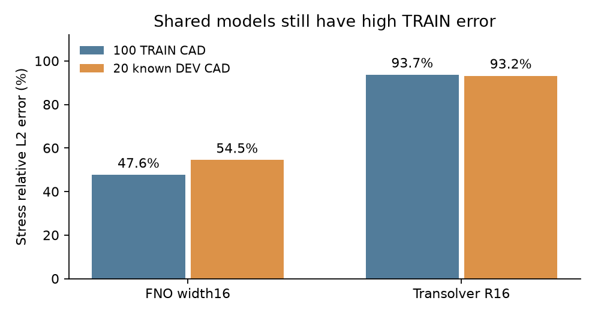

# 当前共享拟合瓶颈

**高误差不能只归因于新CAD迁移：共享模型在训练场上也没有拟合好。**

| 方法／5遍 | 训练CAD应力误差 | 新CAD应力误差 |
|---|---:|---:|
| 宽FNO | 47.64% | 54.45% |
| 原版TS R16 | 93.67% | 93.20% |

宽FNO的训练与新CAD应力差距为6.82个百分点；TS两边都约94%。这是当前短训练配置的观察，不能证明架构上限，也不能从两组均值孤立推断因果。

下一步结合GINO原节点验证，区分共享训练拟合／表示瓶颈与迁移落差。未见明显收益的配置不追加长训练；单样本Hash小于1%仍只说明已知场可拟合。

同100 TRAIN／20 knownDEV CAD、每CAD三载荷、5遍、全原节点physical U(mm)/signed S(MPa)、旧TRAIN40 scaler。仅复用已有指标；模型表示／容量／后端不同，没有新GT、模型推理或FINAL访问。

