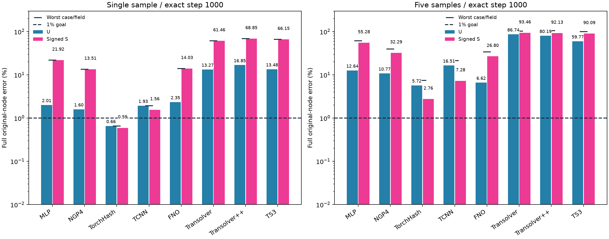

# 参数量与1000步匹配的单/五样本拟合

8种实现约460万有效可训练参数、容差±1%。每项fresh、固定seed2026、相同样本顺序及完整原节点联合U/S损失，Adam固定.001。每次更新一个完整CAD×载荷：单样本1000遍、五样本各200遍。所有方法实际训练1000次，包括提前达1%的方法。表中严格为1000步端点，不是历史最佳或早停结果。

2026-10-14完成16/16项、共16,000次优化更新；每项端点step=1000。仅单样本TorchHash在该端点达到每样本U/S均<1%；五样本八种实现均未全样本达标。TCNN单样本虽在900步曾达到1%，1000步端点已回升，不能以最佳checkpoint替代端点通过。五样本TorchHash的U/S均值为5.7209%/2.7558%，最差字段7.4902%，说明本固定1000步配方仍未充分拟合五样本。

单样本为506_533/ver；五样本另含506_25/tor、10_30/ver、10_421/hor、10_460/dia。每样本含一个CAD和一个载荷，目标为原始全节点signed U3（mm）与signed S（MPa）。输入为归一化XYZ和原25维条件，无样本ID、物理U直通或教师；仅拟合样本用于输出RMS缩放。损失为每样本U向量和S相对L2平方的等权均值，完整原节点读出以FP64计算误差。五样本表列每样本误差的算术均值，验收使用全部样本和字段中的最大误差。

所有模型参数均用于真实模型构造，实际计数在4,562,572–4,617,668之间，相对460万目标为−0.814%至+0.384%。每项已执行完整原节点反向并检查有限梯度；参数配置和实际构造计数见[配置](../../configs/matched_capacity_overfitting.json)与[参数记录](../sample_overfitting/matched_parameter_profiles.json)。

容量匹配调整了宽度、深度、Hash容量或FNO查询头；配置见[matched_capacity_overfitting.json](../../configs/matched_capacity_overfitting.json)。架构与表示仍不同，不声称数学意义上的完全公平、普遍架构排名或泛化精度。NGP4保留四层编码，但扩宽其MLP，区别原小容量NGP。TS++仍保留官方随机Gumbel，端点为一次共享完整读出。

普通模型FP32并允许TF32，TCNN使用官方FP16/FP32 master路径；FNO保留R64网格潜表示和原节点查询头，Transformer保留全原节点全局上下文。因此参数数目和优化更新次数匹配，不代表算力、表示或数值精度完全相同；一个seed2026及一组固定学习率也不足以推断各方法调参后的性能。

完整训练阶段实际成本为**3723.25秒UTC / 3351.35秒单调时钟**，包括导入、缓存、模型构造、训练、评估、保存与退出。终止码0、进程关闭，原14400秒阶段上限未延长；每项均在1800秒窗口内完成。各臂成本见表及[summary.csv](summary.csv)，两种时钟均保留在[metrics.json](metrics.json)。墙钟环境存在差异，其他WSL项目的时间隔离未知，耗时不解释为严格硬件吞吐排名。训练共享读取五份本地TRAIN缓存各一次，held-out读取0；报告导出仅仅读scalar记录，GT/body和科学数组读取0。

|组|方法|参数|U均值%|S均值%|最差字段%|全样本两字段<1%|UTC秒|
|---|---|---:|---:|---:|---:|---|---:|
|single|mlp|4597828|2.0096|21.9173|21.9173|否|75.20|
|single|ngp4|4617668|1.5980|13.5093|13.5093|否|83.65|
|single|hashgrid|4597956|0.6592|0.5941|0.6592|是|40.33|
|single|tcnn_hash|4597120|1.9335|1.5586|1.9335|否|21.34|
|single|fno|4601327|2.3477|14.0305|14.0305|否|46.73|
|single|transolver|4587195|13.2717|61.4560|61.4560|否|211.62|
|single|transolverpp|4610953|16.8516|68.8550|68.8550|否|509.72|
|single|ts3|4562572|13.4763|66.1494|66.1494|否|643.28|
|five|mlp|4597828|12.6351|55.2810|61.5903|否|84.53|
|five|ngp4|4617668|10.7745|32.2907|39.5395|否|95.34|
|five|hashgrid|4597956|5.7209|2.7558|7.4902|否|44.69|
|five|tcnn_hash|4597120|16.5109|7.2806|21.3035|否|28.67|
|five|fno|4601327|6.6166|26.7958|33.9107|否|47.53|
|five|transolver|4587195|86.7433|93.4581|102.4337|否|270.24|
|five|transolverpp|4610953|80.1916|92.1335|104.7997|否|671.90|
|five|ts3|4562572|59.7691|90.0941|100.0006|否|843.69|

逐样本48行误差见[per_case.csv](per_case.csv)。本图的柱为均值，短横线为最差样本/字段；1%验收依据短横线，不依据均值。

旧参数未匹配的拟合与追加Hash结果保留在[sample_overfitting](../sample_overfitting/README.md)，不混入此表。
