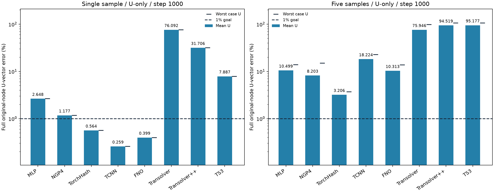

# 只学习位移U：参数匹配、恰好1000步的完整对照

北京时间2026-10-15完成全部16项、共16,000次更新。严格1000步端点，单样本TCNN（0.2588%）、FNO（0.3986%）、TorchHash（0.5638%）通过U<1%目标。五样本所有方法均未每样本通过；本固定配方中TorchHash均值3.2060%、最差3.6931%，其五样本逐项误差均大于1%。实际参数范围4,562,379–4,615,555，相对460万目标−0.818%至+0.338%。

后续[Transolver正确性与学习率诊断](../transolver_fit_diagnostics/README.md)确认：三个模型的适配器/官方路径前向、梯度和一次Adam更新对照差异为0；原版关闭检查点训练100步也复现相同曲线。原版76.0923%接近最佳常量位移基线76.1546%，属于近常量输出、未稳定收敛。仅把其学习率降为1e-4，同seed和1000步端点降到7.9905%，仍未达1%。此主表是固定配方实际端点，不是各方法拟合能力上限；诊断控制独立记录，不替换本表。

参数计数说明：表列注册且requires_grad的参数数目。Transolver++原生condition embedding的1,152个参数在condition=None路径不参与；实测活跃参数为4,609,512，也满足目标±1%。该口径差异不影响本轮误差和更新数，但不能把注册计数全部称为实际参与计算的参数。

8种方法各约460万可训练参数（±1%），单/五样本共16项全部fresh seed2026，各恰好1000次优化更新。输出为signed Ux/Uy/Uz（mm），损失只有完整U向量相对L2平方，不读取应力标签，不从U/S联合模型抽取U代替U-only训练。Adam固定.001，无早停或plateau降学习率；主表严格是1000步端点。

单样本506_533/ver；五样本另含506_25/tor、10_30/ver、10_421/hor、10_460/dia。一次更新完整一个原节点CAD×载荷，五样本各200遍。归一化XYZ+原25维条件输入；无样本ID、物理U直通、教师或held-out。输出尺度仅用拟合样本U向量RMS；每样本完整节点误差FP64读出，表中均值为案例误差算术均值，验收每样本U均<1%。

模型容量设置沿用[联合场参数匹配配置](../../configs/matched_capacity_overfitting.json)的宽度、深度与编码容量，但末端输出改为3通道；实际参数逐项构造检查。TCNN保留原生对齐，FP16计算/FP32 master；其他模型FP32/TF32。FNO仍R64潜表示+原节点查询头，Transformer保留全节点全局上下文；TS++保留官方eval随机Gumbel，单次端点不表示多次随机读出均通过。一个种子与固定配方仅是训练拟合诊断，不代表泛化或普遍架构排名。

本轮[U-only配置](../../configs/matched_capacity_u_overfitting.json)与旧联合场实验分别fresh训练。旧联合场单样本TCNN/FNO/TorchHash的U为1.9335%/2.3477%/0.6592%，本轮为0.2588%/0.3986%/0.5638%；五样本TCNN和FNO的U均值由16.5109%/6.6166%变为18.2245%/10.3129%，因此U-only在本固定配方下没有普遍改善每个方法。输出头维度、目标和随机初始化同时改变，差异不能全归因于去掉S损失；本轮只回答U-only固定容量、固定1000步的实际拟合结果。

完整训练阶段成本3275.65秒UTC / 3006.64秒单调时钟，含导入、缓存、初始化、训练、完整读出、保存和退出；终止码0且预算内。五份本地TRAIN缓存各共享读取一次，应力标签/held-out读取0；导出只读scalar，不加载模型、GT或科学数组。其他WSL项目的时间隔离未知，耗时不是严格硬件吞吐排名。

|组|方法|实际参数|更新|U均值%|最差U%|每样本U<1%|UTC秒|单调秒|
|---|---|---:|---:|---:|---:|---|---:|---:|
|single|MLP|4596595|1000|2.6480|2.6480|否|56.48|53.52|
|single|NGP4|4615555|1000|1.1766|1.1766|否|62.18|56.27|
|single|TorchHash|4597251|1000|0.5638|0.5638|是|30.41|27.45|
|single|TCNN|4597120|1000|0.2588|0.2588|是|11.73|11.73|
|single|FNO|4601006|1000|0.3986|0.3986|是|28.37|25.41|
|single|Transolver|4586786|1000|76.0923|76.0923|否|197.69|179.95|
|single|Transolver++|4610664|1000|31.7058|31.7058|否|474.22|435.79|
|single|TS3|4562379|1000|7.8873|7.8873|否|556.24|508.94|
|five|MLP|4596595|1000|10.4991|13.8781|否|74.66|68.74|
|five|NGP4|4615555|1000|8.2033|14.9528|否|79.68|73.76|
|five|TorchHash|4597251|1000|3.2060|3.6931|否|38.27|35.32|
|five|TCNN|4597120|1000|18.2245|22.8650|否|17.94|14.98|
|five|FNO|4601006|1000|10.3129|13.7966|否|31.78|28.82|
|five|Transolver|4586786|1000|75.9460|98.7650|否|254.83|234.14|
|five|Transolver++|4610664|1000|94.5188|105.7608|否|625.62|575.37|
|five|TS3|4562379|1000|95.1775|105.7383|否|731.33|672.20|

两幅图使用相同对数纵轴并显示1%线；柱为U均值，右侧短横线为最差案例U。五样本验收依据最差案例，不用均值代替。每项完整节点反向检查有限梯度，1000步端点预测已保存；科学实现完成不等于数值目标达标。

[16项汇总](summary.csv) · [48行逐案例误差](per_case.csv) · [配置与完整成本](metrics.json) · [实际参数记录](../sample_overfitting/u_only_parameter_profiles.json)

完整端点节点预测及last.pt留在本地运行目录，不上传科学数组或模型。[此前U/S联合对照](../matched_capacity_overfitting/README.md)独立保留，不能与本轮混成同一目标训练。
