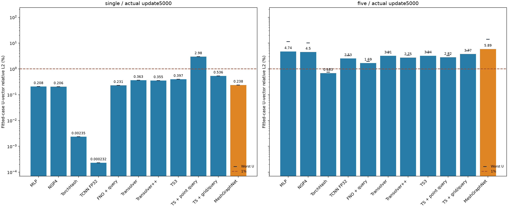
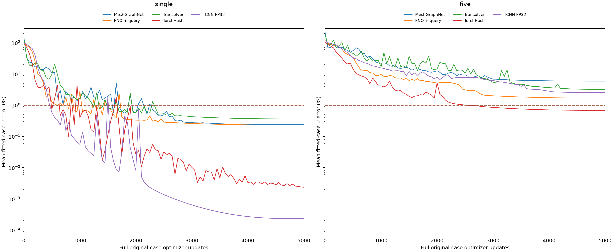

# MeshGraphNet：单/五样本完整5000步

用户要求先完成单/五样本。新增两项均actual5000/endstep5000，每案例分别5000/1000遍；已有30个端点原样保留，当前32项。50样本MeshGraphNet未训练，以—占位，不用任何中间值代替。

采用DeepMind官方[Encode-Process-Decode结构](https://github.com/google-deepmind/deepmind-research/blob/master/meshgraphnets/core_model.py)的PyTorch静态位移适配：15个独立消息传递模块、宽180、各MLP两隐藏ReLU层；encoder/processor带LayerNorm，decoder不带；先更新边delta、按receiver求和更新node，再分别加残差。参数注册和实际活跃均4,603,863。不是官方TensorFlow运行时、论文默认宽128或动态rollout复现，也没有真实历史位移/速度作为输入。

节点为全部原始FEM节点，输入normalizedXYZ+25原条件。图由原TETRA10的六条二次边在原中点处分为12段，双向去重，保留所有中间节点；非kNN或抽样点云图。边输入为normalized mesh-coordinate差向量3维及长度1维。MeshGraphNet额外利用真实网格连接，而旧点场模型不使用该连接，属于不同几何表示的比较。无teacher/physicsU/sampleID/额外stress/heldout。

总预算约460万±1%，freshseed2026，U3signedmm/vectorrelativeL2²；同Adam fused betas(.9,.999)/eps1e-8/wd0、clipL2=1、eval50，OneCycle5000/pct_start.1/peak1e-3/div25/finaldiv1000/cos两阶段/no momentumcycle；实际首步4e-5、第500峰值.001、第5000用4e-8。没有early stop或达到1%停。FP32允许TF32，与TS/FNO一致；TCNN保留其原生FP32禁TF32的标注。节点和边MLP分块/checkpoint只控制显存，测试验证完整图前向与参数梯度，不做独立子图或邻居采样。

## 全方法精度与耗时总表

误差单位为%，五/50样本为均值 / 最差；时间为分钟，含构造、训练、评价、存盘和恢复的实际执行成本。全部已训练项均为完整5000更新，MGN50未训练。

|方法|单样本U%|五样本U% 均值/最差|50样本U% 均值/最差|单样本min|五样本min|50样本min|
|---|---:|---:|---:|---:|---:|---:|
|MLP|0.207500|4.7428 / 11.3329|29.5333 / 77.0690|4.31|5.69|12.14|
|NGP4|0.205676|4.4985 / 10.1729|29.1136 / 73.1583|4.45|5.99|12.76|
|TorchHash|0.002353|0.6831 / 0.7506|21.3929 / 47.5205|2.28|3.08|5.58|
|TCNN FP32|0.000232|2.5335 / 3.2684|28.0900 / 64.6782|0.87|0.98|1.35|
|FNO + query|0.230503|1.6939 / 1.9405|9.9989 / 17.0790|2.07|2.42|4.84|
|Transolver|0.362831|3.2076 / 4.4722|25.1500 / 61.4277|13.91|18.63|35.15|
|Transolver++|0.354917|2.7529 / 3.4265|25.6559 / 62.0583|33.55|47.24|84.92|
|TS3|0.397055|3.2396 / 4.4200|24.9284 / 66.2128|38.01|51.18|92.79|
|TS + point query|2.983386|2.8212 / 3.2678|28.8945 / 61.8193|13.87|18.20|31.48|
|TS + grid/query|0.535807|3.7650 / 5.0513|27.0709 / 79.5382|28.34|29.13|36.00|
|MeshGraphNet|0.237797|5.8858 / 14.0877|—|70.07|115.23|—|

本次原生阶段实际成本4216.61s UTC / 3911.59s单调时钟。用户在启动后收窄范围，原进程已共享加载50个TRAIN U案例和50个图缓存；这笔成本如实计入，只有单/五组被训练。图预处理另读50份H5的vertices/cells及已对齐XYZ，不读目标；耗时14.2066s，见[图元数据](../../configs/meshgraphnet_graphs.json)。完整图合成数据预检只测显存/速度，0个目标标签、0个optimizer更新，不作为训练结果。

范围控制说明：为不修改live配置、不重置已进行的单样本更新，预先创建第三项目录，阻止50项初始化。原单样本完整、五样本显存失败后，原进程遇到这个预设目录，以FileExistsError退出1；五样本随后单独恢复完成，见下文。原进程不能称原生exit0。报告保留真实terminal，包括由非零退出造成的within_budget=false，并单列原绝对截止时间遵守情况。两个选定训练项均完整5000，模型/Adam/scheduler/四RNG/order/cursor及6份端点预测本地保留，无50样本模型初始化。若任何选定项不足5000或出现其他失败，导出器会拒绝。

[新增2项](summary.csv) · [新增6案例](per_case.csv) · [全部32项及耗时/精度](all_methods.csv) · [原30项](../transolver_hybrid_ablations/README.md)

## 五样本显存失败与精确恢复

原单样本完整5000保留。五样本原阶段完成4次更新，第5步前向后、反向前触发声明显存上限；原scope目录随后阻止50项初始化。原exit1同时包含真实MemoryError，不能仅称范围受控停止。恢复仅读本次失败的last.pt一次，严格恢复模型、Adam、OneCycle、四RNG、输出尺度、案例顺序和cursor；丢弃未反向的前向图，从第5步继续4996次，未从零重跑。缓存改为CPU驻留，每次一完整原网格转GPU；架构、精度、全节点损失、评价频率均不变，无额外初始评价或RNG抽样。原arm/whole绝对截止不延长，等待和重启间隔不返还。额外5次TRAIN U读取和5次图读取，累计各55，stress/heldout为0。原阶段加恢复阶段实际成本11126.32s UTC / 10214.93s单调时钟；等待不重复计为执行成本。恢复原生exit0及其terminal另行完整保留。

## 本轮结果解读

MeshGraphNet单样本U为0.237797%，与FNO的0.230503%接近，比原版TS的0.362831%低；TorchHash的0.002353%与原生FP32 TCNN的0.000232%仍更低。五样本MGN均值5.885819%、最差14.087667%，高于FNO的1.693941%/1.940470%、原版TS的3.207639%/4.472225%、TorchHash的0.683088%/0.750562%及TCNN的2.533477%/3.268367%。这次MGN没有改善多样本拟合，不能从单样本表现推断五样本表现。

MGN单/五耗时4204.50s/6914.04s，约为FNO对应耗时的33.8倍/47.6倍；五样本约为原版TS的6.2倍。此处MGN五样本含原失败4步的5.15s和恢复的全部实际执行成本，CPU传输、逐case显存释放、15轮全图消息传递及嵌套checkpoint重算均包含在内；不同后端的时间不是纯算子基准，也不能把差异全归因于某一个因素。MGN的15轮局部消息传递与FNO全局网格运算属于不同结构，当前结果不能单独证明误差差距的原因或架构极限。

五个案例的U误差如下；这是完整第5000步端点，不是最佳中间步：

|案例|U相对L2 %|
|---|---:|
|506_533/ver|14.087667|
|506_25/tor|2.102089|
|10_30/ver|9.222427|
|10_421/hor|1.858779|
|10_460/dia|2.158131|

这组比较为同种子、约同参数量、同5000更新的TRAIN拟合。每update仅一完整case，五样本每case1000遍；不是5000个全组epoch。真实网格连接是MGN额外几何表示，精度/后端/缓存驻留亦有披露，不能称数学输入完全一致或泛化排名。MGN50样本没有运行。

## 成本与交付核验

原训练阶段4216.605908s UTC / 3911.594276s单调时钟；恢复阶段6909.714612s / 6303.338289s。合计11126.320520s UTC（3小时05分26秒）/ 10214.932564s单调时钟。间隔和观察等待没有重复算为执行成本，但均消耗原绝对截止余量。图构建另计14.206595s；首次路径错误预检0.263676s（任何forward/backward前退出），修正后的纯合成图诊断5.947455s（两次全图forward/backward共5.353444s）。这些准备/诊断共20.417726s，连同两训练阶段为11146.738246s已记录UTC成本；诊断目标标签和optimizer更新均为0。旧30项的历史训练成本不重算、不计作本轮新训练。

原stage预加载50份TRAIN U和50图缓存，恢复额外5份U和5图，累计各55；图构建另读50份H5几何和50份已对齐XYZ，目标0。stress/heldout读取始终0。原显存失败和非零退出完整保留，恢复原生exit0、未超预算、原绝对截止未延长，两个精确guard/child均已退出。所有模型和恢复状态、6份原节点预测留本地。

15项相关测试已通过（含真实小图前向/全参数梯度、4→5 Adam/RNG接续、deadline不延长、拒绝部分端点）；测试不等于精度资格。导出只运行一次且只读scalar，输出2新增端点/6案例、32汇总/566案例/3232曲线点。逐项5000、末步LR4e-8、参数预算、case访问次数、均值/最差来源以及旧30行完整保留均已核验；两个PNG已视觉验收。
