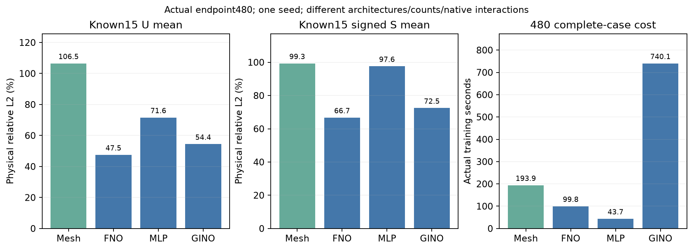

# 多尺度网格求解器：固定480初筛

一个新mesh家族，原25含实际载荷、direct4、宽度32及四个learned V-cycle。完整真实节点/边与粗到细支持，不接Hash。

| 固定端点 | 位移 mean / worst % | signed stress mean / worst / hotspot % |
|---|---:|---:|
| known15 | 106.48 / 143.52 | 99.30 / 102.99 / 99.55 |
| DEV5 dia | 85.61 / 87.83 | 92.10 / 93.55 / 97.07 |

实际训练193.91秒，raw wall 215.98秒；参数86500。缓存准备、读入/H2D、推断与peak分列于JSON，重叠计时不相加。

两场均值未优于历史FNO480，本配置当前没有精度选型优势。 四pass不是收敛或整个家族有效性的结论。

历史同480 known15，仅作上下文：

| 方法 | U / S mean % | 实际训练秒 |
|---|---:|---:|
| FNO direct4 | 47.51 / 66.71 | 99.78 |
| MLP direct4 | 71.59 / 97.60 | 43.70 |
| GINO | 54.42 / 72.46 | 740.12 |
| FNO force-free u9 | 35.03 / 76.97 | 104.18 |
| BC DeepONet u9 | 68.86 / 95.36 | 52.29 |

这些结构的参数、局部交互与输入图不同，不是同容量或拓扑单因素因果实验。完整曲线、最差ID、首正式全案例梯度收据、实际层级节点数/边数/P-R支持与物理单位见[metrics.json](metrics.json)。

support-reference角色不等于节点Dirichlet，图/mass不是刚度矩阵。DEVdia已探索；旧final和新sealed test保持关闭。本初筛不新增P2监督或应变GT声明。

