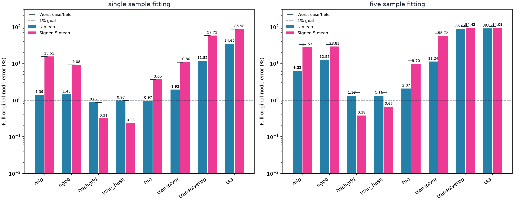
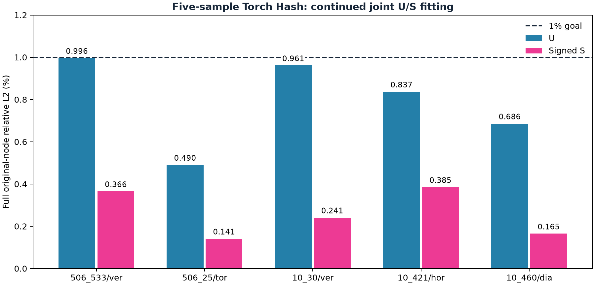

# 单样本与五样本过拟合

最新的[只学习U、参数量匹配、每项恰好1000步对照](../matched_capacity_u_overfitting/README.md)已完成；此前[U/S联合匹配对照](../matched_capacity_overfitting/README.md)独立保留。本页保留不同容量、可早停、最佳checkpoint和Hash追加训练结果，不混入最新主表。

本轮对照已完成：8种实现各做单/五样本联合拟合，另对五样本Torch Hash保留Adam状态续训。**单样本Torch/TCNN Hash及续训后的五样本Torch Hash达到每样本U/S均<1%**；不是所有方法达标。五样本达标checkpoint为32,100步，最差U0.9964%、最差S0.3855%，该模型原臂+追加stage成本合计1239.59秒UTC / 1116.90秒单调时钟。下方保留初始固定预算结果与追加结果，不能混为同预算排名。

当前范围仅训练样本拟合，目标是**同一个 checkpoint 下，每个样本的原始全节点位移 U3 与原始有符号应力 S 相对 L2 都严格低于1%**。五样本以最差样本、最差字段验收，不用 pooled 或平均误差替代。

单样本：506_533/ver。五样本：506_533/ver、506_25/tor、10_30/ver、10_421/hor、10_460/dia。“样本”指 CAD×载荷，不是5个CAD的全部载荷。

## 已有结果

以下是已保存的历史 checkpoint 指标，未重训或重新读取标签。容量、优化器、训练预算、输出变换和 checkpoint 选择规则不同，因此不是统一配方排名。缺失 U/S 写 —，不是0或达标。NGP 的 U-only 与 S-only 是不同模型，不能组合成同一联合模型达标。FNO 只列 FEM 原节点误差；网格/教师拟合误差另属不同指标。

|历史实验|样本数|U均值 / 最差 %|S均值 / 最差 %|实际训练更新|保存耗时|
|---|---:|---:|---:|---:|---:|
|mlp_single_exact|1|3.6371 / 3.6371|39.5151 / 39.5151|500|4.23s|
|ngp4_506_533_ver_u|1|0.9098 / 0.9098|—|1000|3.38s|
|ngp4_506_533_ver_stress|1|—|11.4500 / 11.4500|1000|3.65s|
|hash_single_exact|1|—|0.2891 / 0.2891|1000|6.28s|
|tcnn_hash_single_exact|1|—|0.4139 / 0.4139|1000|18.37s|
|transolver_single|1|32.6796 / 32.6796|86.5268 / 86.5268|500|46.27s|
|transolverpp_single_asinh|1|75.3937 / 75.3937|91.6117 / 91.6117|500|201.62s|
|ts3_single|1|33.7082 / 33.7082|85.6180 / 85.6180|500|210.29s|
|fno64_joint|1|2.2550 / 2.2550|30.3707 / 30.3707|500|12.40s|
|fno64_stress|1|—|30.3615 / 30.3615|500|12.17s|
|fno192_stress|1|—|14.3410 / 14.3410|9905|1618.98s|
|fno192_hash_distill|1|—|21.0019 / 21.0019|1000|6.12s|
|hash_five_aligned|5|—|2.5344 / 3.4032|1000|11.30s|
|tcnn_hash_five_aligned|5|—|1.4495 / 2.1123|1000|52.08s|
|transolver_five|5|78.1169 / 116.1405|91.7700 / 102.3831|2500|297.52s|
|transolverpp_five|5|66.5833 / 106.4847|90.5632 / 102.3735|2500|1317.79s|
|ts3_five|5|81.1581 / 103.9008|92.1389 / 100.9027|2500|1447.98s|

历史中尚无表内方法证明单样本或五样本联合 U/S 均达到1%。单样本 Hash 的 S-only 已低于1%；五样本 TCNN Hash 的 S 均值约1.45%、最差2.11%。Transolver 系列历史预算内远未拟合好。MLP、NGP、FNO 的五样本联合结果缺失，保留为空，不用跨CAD结果填充。

## 新的统一目标试验

[配置](../../configs/sample_overfitting.json)固定8种实现：MLP、4-level NGP、12-level Torch Hash、官方 TCNN Hash、带原节点查询头的 FNO、原版 Transolver、Transolver++、Transolver-3。每种分别 fresh 单样本和五样本；seed2026，不旧 checkpoint 暖启、不残差教师、不加入物理输入或样本ID。每次更新完整一个原节点样本，五样本循环；所有方法联合输出 U3/S，训练目标为两个字段物理相对 L2平方的等权均值。仅这些拟合样本确定输出尺度，和原跨CAD实验的 TRAIN40 scaler 区分。学习率从.001开始，训练集最差字段指标停滞时统一减半到1e-5。

FNO 新使用 R64 输入表示、native XYZ/BC 查询头，并在原始节点上监督；区别于旧网格输出再插值的 FNO。Transformer 全部原节点参与每层全局上下文，不以独立小块更换模型。TS++保留官方随机 Gumbel，单次训练集读出达标不表示重复读出都满足1%。普通模型 FP32、TF32加速；TCNN按官方 FP16/FP32 master。参数量和成本分别记录，不声称等容量排名。

每臂固定600秒（其中末60秒预留读出/保存）、最多20000次更新；全阶段10800秒上限含导入、缓存、训练、读出、保存和退出。每100步完整读出 U/S、保留同一个最差字段最优 checkpoint；两字段所有样本低于1%提前结束，否则诚实报告预算内未达标。固定预算是上限，不是完成时间估计。真实模型异常保留已完成步骤与 Adam/RNG/顺序/游标，未自动重放。数值目标与实现完成分别判断。

新运行结果保留在本地 runs/sample_overfitting；完成后在此目录添加标注配置和逐样本误差的新结果，历史表保持独立。这是训练集记忆能力诊断，不是泛化、独立测试或工程精度证明。

## 新实验实际结果

完整16臂均已尝试；运行完成不等于1%目标通过。每行是同一个最差字段指标最优 checkpoint，不逐样本/字段另挑最低值。

|样本组|方法|U均值%|S均值%|最差样本/字段%|两字段全部<1%|实际更新|UTC耗时秒|
|---|---|---:|---:|---:|---|---:|---:|
|single|mlp|1.3881|15.5103|15.5103|否|20000|257.03|
|single|ngp4|1.4260|9.0798|9.0798|否|20000|313.54|
|single|hashgrid|0.8697|0.3145|0.8697|是|600|24.26|
|single|tcnn_hash|0.9739|0.2349|0.9739|是|500|11.67|
|single|fno|0.9650|3.6510|3.6510|否|15878|540.26|
|single|transolver|1.9252|10.8622|10.8622|否|4281|540.46|
|single|transolverpp|11.8182|57.7325|57.7325|否|976|541.39|
|single|ts3|34.6504|85.9777|85.9777|否|907|541.60|
|five|mlp|6.3214|27.5659|32.3653|否|20000|342.49|
|five|ngp4|12.5464|28.8277|32.8761|否|20000|394.20|
|five|hashgrid|1.3280|0.3801|1.5818|否|13726|540.64|
|five|tcnn_hash|1.3088|0.6652|1.6483|否|20000|375.59|
|five|fno|2.0746|9.7032|11.7372|否|17510|540.24|
|five|transolver|11.2399|55.7153|67.3318|否|3542|540.40|
|five|transolverpp|85.8073|94.4210|101.4668|否|800|541.53|
|five|ts3|89.8205|94.0864|100.9323|否|740|541.69|

逐样本误差见 [current_per_case.csv](current_per_case.csv)，含失败/缺失的固定48行分母。完整阶段成本见 [current_metrics.json](current_metrics.json)。这是训练拟合结果，不是新的泛化结论。

## 后续五样本续训

初始16臂固定实验已结束，成本6595.04秒UTC / 5933.74秒单调时钟。仅五样本Torch Hash从同一最佳13,726步checkpoint继续，原模型/Adam/降学习率状态/四RNG/顺序与游标恢复；不架构修改或重新初始化训练。原轮末次只有未提交的部分反向梯度，可丢弃而不重复已完成优化步。新增最多20,000步、900秒臂窗口（末60秒读出/保存）、1200秒whole独立成本；这是明确的追加训练，不是失败恢复或原16臂预算重置。旧结果表和曲线保留，新追加结果单独列出。

## 五样本续训实际结果

从13726步保留模型、Adam、scheduler、四RNG与游标继续；新增18374步，实际总更新32100，同一最优checkpoint为32100步。额外stage耗时698.95秒UTC / 629.64秒单调时钟，原Hash臂成本另外保留，不与原16臂混成同预算排名。
每样本两字段均严格低于1%：通过；最差字段0.9964%。其他骨干原轮未达标的事实保持不变。

|样本|U %|S %|
|---|---:|---:|
|506_533/ver|0.9964|0.3655|
|506_25/tor|0.4904|0.1412|
|10_30/ver|0.9614|0.2412|
|10_421/hor|0.8372|0.3855|
|10_460/dia|0.6862|0.1651|

[完整追加成本及指标](hash_continuation_metrics.json)。五样本训练拟合，不是泛化或独立测试精度。
