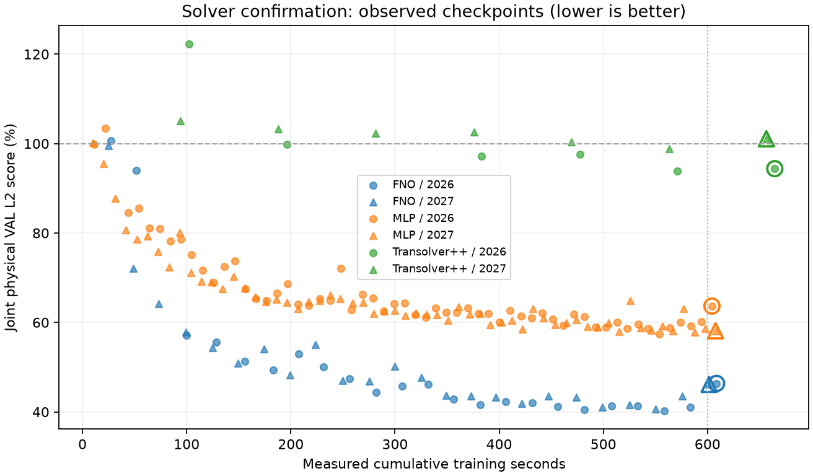

# GeoBC 求解器确认轮

已完成 6/6；候选已冻结。固定累计训练成本端点为主结果，共同VAL分数best为次结果。

冻结的候选依据：FNO: clear joint U/stress learning; MLP: low-cost displacement/control route; Transolver++: one lower-priority slow structural route with declining U. Hash held because worst U191.41% and late U reversal; original/TS3 near zero-field and final score reversal. No route-specific objective or hyperparameter optimization.

| 候选 / seed | 状态 / step / stop | 预算端点 U mean / worst % | S mean / worst / hotspot % | actual / parent / incremental训练秒 | 超额秒 |
|---|---|---:|---:|---:|---:|
| FNO / 2026 | completed / 2880 / train_budget_seconds | 36.28 / 75.61 | 56.45 / 75.48 / 45.58 | 608.68 / 99.78 / 508.90 | 8.68 |
| FNO / 2027 | completed / 2880 / train_budget_seconds | 36.22 / 72.07 | 56.07 / 73.32 / 44.17 | 601.58 / 0.00 / 601.58 | 1.58 |
| MLP / 2026 | completed / 7080 / train_budget_seconds | 51.69 / 128.20 | 75.62 / 96.79 / 69.07 | 604.22 / 43.70 / 560.52 | 4.22 |
| MLP / 2027 | completed / 7080 / train_budget_seconds | 43.01 / 63.87 | 73.24 / 82.56 / 68.57 | 607.66 / 0.00 / 607.66 | 7.66 |
| Transolver++ / 2026 | completed / 840 / train_budget_seconds | 90.32 / 104.90 | 98.45 / 100.05 / 99.41 | 664.55 / 382.87 / 281.69 | 64.55 |
| Transolver++ / 2027 | completed / 840 / train_budget_seconds | 103.55 / 128.86 | 98.57 / 100.67 / 99.42 | 656.47 / 0.00 / 656.47 | 56.47 |

| 同一候选 / seed | 次结果：共同VAL best step | U mean / worst % | S mean / worst / hotspot % | best累计训练秒 |
|---|---|---:|---:|---:|
| FNO / 2026 | 2640 | 25.07 / 43.30 | 55.44 / 73.61 / 44.76 | 558.21 |
| FNO / 2027 | 2640 | 26.28 / 45.58 | 55.05 / 72.42 / 43.65 | 550.31 |
| MLP / 2026 | 6480 | 42.17 / 60.97 | 72.64 / 82.08 / 69.96 | 553.70 |
| MLP / 2027 | 6840 | 42.99 / 59.33 | 72.70 / 84.34 / 68.32 | 587.45 |
| Transolver++ / 2026 | 720 | 89.84 / 105.81 | 97.95 / 100.19 / 99.04 | 570.90 |
| Transolver++ / 2027 | 720 | 99.69 / 105.20 | 98.05 / 100.02 / 99.10 | 563.05 |

未完成组的主/次结果留空；最新已测端点仅在metrics.json标为provisional。实际600秒附近按完整pass停，max_steps安全上限未达预算时单列；不能把超额或父成本抹去。

相同40/5 CAD、三known-load、TRAIN-only共同scaler/global32/input与固定配方；seed2026沿screen last480轨迹及Adam/RNG接续，seed2027 fresh，cloud_seed2026不变。热点仅指源应力最高1%节点，U热点未测；表中误差均为物理解码后全原节点指标。

两个seed逐一报告，不宣称统计显著，不按均值低于100%自动宣布胜出。FNO适配/分辨率限制、慢路线尚未充分收敛和反复使用开发验证的限制保留；final5/dia继续隔离。完整历史、每case指标、参数/显存/推断成本见[metrics.json](metrics.json)。

散点为真实累计训练秒/已提交评估，无插值；大空心点标完成的预算端点。
