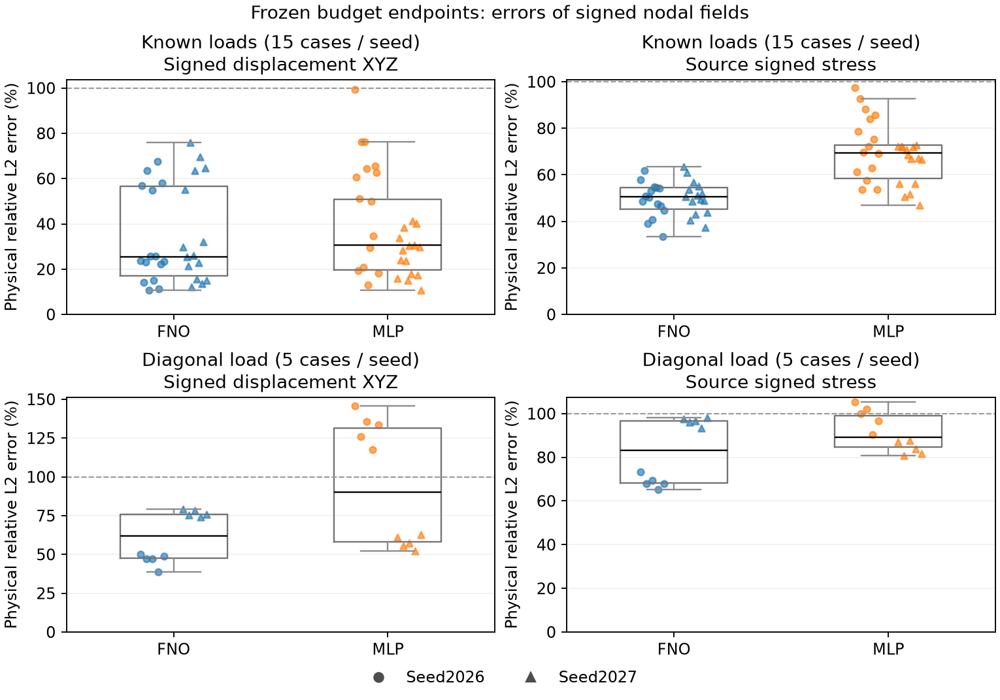

# GeoBC 冻结最终评估

主结果：预先固定的600秒累计训练预算端点，seed2026与2027分别报告。以下范围来自两个seed的各自case-mean；最差值跨两seed和所有该组case。

**已知载荷：未见final5 CAD × ver/hor/tor，共15case。**

| 方法 | 两seed U case-mean范围 % | 两seed S case-mean范围 % | 两seed最差case U % | 两seed最差case S % |
|---|---:|---:|---:|---:|
| FNO | 33.09–36.17 | 49.23–50.39 | 75.93 | 63.61 |
| MLP | 26.53–49.40 | 64.20–73.49 | 99.20 | 97.62 |

**组合载荷：同final5 CAD × dia，共5case，独立于上表。**

| 方法 | 两seed U case-mean范围 % | 两seed S case-mean范围 % | 两seed最差case U % | 两seed最差case S % |
|---|---:|---:|---:|---:|
| FNO | 46.43–76.51 | 68.78–96.31 | 79.27 | 98.12 |
| MLP | 57.71–131.70 | 84.19–98.90 | 145.86 | 105.42 |

两seed不构成统计显著性证据，最终评估不用于选赢家或反馈训练。U保留signed XYZ，S保留源signed scalar；误差在全原始节点物理解码后计算，单位为mm / MPa。热点仅源|stress|最高1%节点，worst case ID、物理RMS/MAE/max、每case指标见[metrics.json](metrics.json)。

共同VAL-best作为次结果仅列入JSON，保留checkpoint角色、selected step与screen/confirmation来源。实际累计训练秒（parent / incremental / overshoot）、初始化、缓存加载、推断/评估时间、显存/参数和共享checkpoint去重计数均分开记录；不将训练预算和评估开销混为同一成本。

每点是一个case和固定seed，箱体仅描述这些值；100%虚线是raw-zero基准，不表示连续场或边界条件性能。
