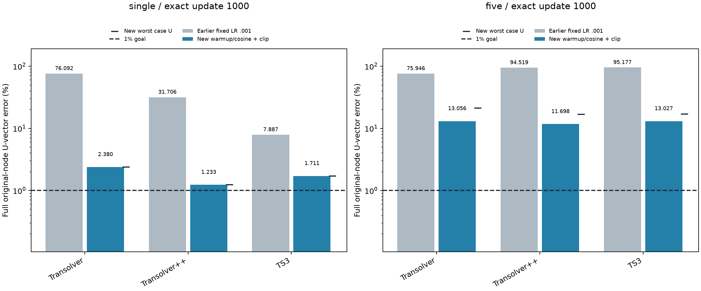

# 历史1000步U-only过拟合：训练配方调整后重做

**最新结果见[全部8方法统一OneCycle、完整5000步对照](../fullcycle_u_overfitting/README.md)**。本页保留上午完成的1000步阶段，不再代表最新端点；新对照16项均实际5000更新，所有单样本U<1%，五样本仅TorchHash全部<1%。

北京时间2026-10-16T10:03:26.248100+08:00完成6项重做，每项fresh seed2026、恰好1000次完整原节点更新。下表直接使用本轮新端点；未重做的方法标注保留旧配方。原固定配方表作为历史保留，不再用其Transolver旧值代表最新结果。

六个配对端点全部改善：单样本Transolver从76.0923%降至2.3795%、++从31.7058%降至1.2334%、TS3从7.8873%降至1.7112%；五样本U均值分别从75.9460%/94.5188%/95.1775%降至13.0556%/11.6977%/13.0275%。本轮仍为0/6项达到每样本U<1%，不把接近目标或训练完成写成精度通过。

预先固定Adam峰值学习率0.0001，前50步线性warmup，再余弦降到1e-06；每步全参数梯度L2范数裁剪1。架构、U-only目标、样本顺序、参数匹配、精度和1000更新规则保持不变。配方同时改变学习率过程和裁剪，是重做结果，不是仅学习率单变量因果实验。

单样本506_533/ver；五样本另含506_25/tor、10_30/ver、10_421/hor、10_460/dia。一更新完整一个CAD×载荷，single1000遍、five每样本200遍。输入归一化XYZ+25维原条件，输出signed Ux/Uy/Uz(mm)，完整U向量相对L2平方损失，输出RMS仅用拟合样本；无样本ID、物理U直通、teacher、应力标签或held-out。FP32/TF32，TCNN若在重做范围则仍原生FP16/FP32master；TS++保留官方eval随机Gumbel，单次端点不保证重复读出都通过。

所有重做项的注册及实际梯度参与参数数目均检查在460万±1%内；++无条件输入分支的原生embedding不参与，单独报告活跃参数。验收是每样本完整原节点FP64 U误差均<1%，不是pooled均值。只用严格1000步端点，不用最佳checkpoint或提前通过的值替代。新结果不保证每个方法更优或达1%；一个seed和固定配方不代表架构上限或泛化排名。

新阶段总成本2420.14秒UTC / 2216.16秒单调时钟，含导入、缓存、构造、训练、完整读出、保存及退出；终止码0、未扩展固定预算。5份TRAIN缓存各共享读取一次，stress/held-out读取0。完整端点预测和恢复checkpoint留本地。旧阶段成本保留独立，不把新训练伪装为旧阶段免费更新；其他WSL项目时间隔离未知。

## 最新全部方法汇总

以下是最新完成配置的索引。各行清楚标明是否本轮重做；若范围未覆盖全部8种方法，不是相同学习率配方排名。

|方法|单样本U%|五样本U均值%|五样本最差U%|当前配置来源|
|---|---:|---:|---:|---|
|MLP|2.6480|10.4991|13.8781|保留原fixed .001|
|NGP4|1.1766|8.2033|14.9528|保留原fixed .001|
|TorchHash|0.5638|3.2060|3.6931|保留原fixed .001|
|TCNN|0.2588|18.2245|22.8650|保留原fixed .001|
|FNO|0.3986|10.3129|13.7966|保留原fixed .001|
|Transolver|2.3795|13.0556|21.2482|本轮warmup/cosine+clip重做|
|Transolver++|1.2334|11.6977|16.7739|本轮warmup/cosine+clip重做|
|TS3|1.7112|13.0275|17.0505|本轮warmup/cosine+clip重做|

## 本轮完整重做结果

|组|方法|注册参数|活跃参数|更新|U均值%|最差U%|全样本U<1%|UTC秒|
|---|---|---:|---:|---:|---:|---:|---|---:|
|single|Transolver|4586786|4586786|1000|2.3795|2.3795|否|171.25|
|single|Transolver++|4610664|4609512|1000|1.2334|1.2334|否|411.56|
|single|TS3|4562379|4562379|1000|1.7112|1.7112|否|465.98|
|five|Transolver|4586786|4586786|1000|13.0556|21.2482|否|219.52|
|five|Transolver++|4610664|4609512|1000|11.6977|16.7739|否|537.40|
|five|TS3|4562379|4562379|1000|13.0275|17.0505|否|611.37|

[最新全部方法CSV](latest_all_methods.csv) · [最新48行逐样本误差](latest_per_case.csv) · [本轮汇总](summary.csv) · [本轮18行误差](per_case.csv) · [配置和成本](metrics.json)

最新48行案例CSV已合并本轮18行与五种未重做方法的原30行，每行都有source_report和protocol。原[48行案例CSV](../matched_capacity_u_overfitting/per_case.csv)保留作历史，其中Transolver系列18行不再是最新值。

[原统一fixed .001对照](../matched_capacity_u_overfitting/README.md) · [原版单独fixed .0001诊断](../transolver_fit_diagnostics/README.md)
