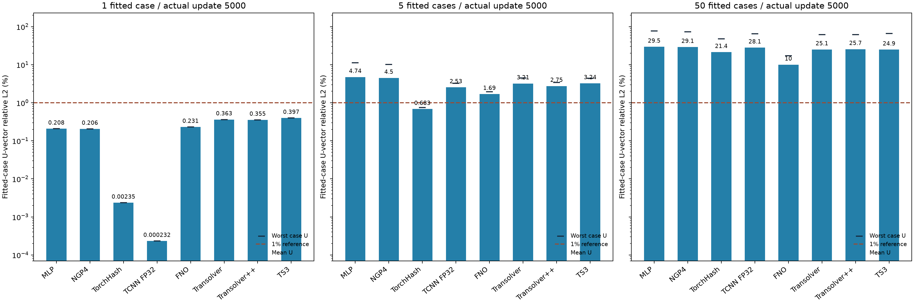
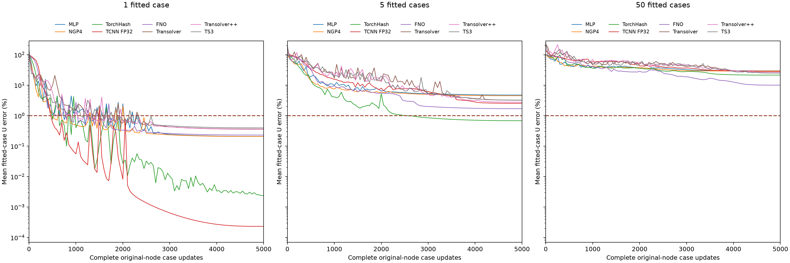

# TCNN原生FP32：1/5/50样本完整5000步

最新索引：[TS两种混合消融后的30项报告](../transolver_hybrid_ablations/README.md)保留本报告端点，增加6项完整5000步TS混合结果；本报告作为历史阶段保留。

用户要求TCNN改为FP32后，这三项均从seed2026重新初始化、完整训练5000次原节点更新，无早停。其余21项保留已交付的真实5000步标量。旧TCNN FP16结果保留在[历史报告](../fifty_u_overfitting/README.md)及[历史标量](historical_tcnn_fp16.csv)。

TCNN本地源码以TCNN_HALF_PRECISION=0构建独立扩展，运行时核验native dtype=torch.float32及实际CutlassMLP后端。官方FullyFusedMLP路径采用FP16；FP32使用官方CutlassMLP，因此这不是单独改变输出cast。哈希编码/层宽深、约460万实际注册与活跃参数均保留。禁用PyTorch matmul/cuDNN TF32，并设置NVIDIA_TF32_OVERRIDE=0；无AMP。其他21项的历史FP32计算允许TF32，因此整张表不能称为所有方法完全相同数值精度的比较。

Adam fused betas(.9,.999)、eps1e-8、wd0；OneCycle5000/pct_start.1/peak1e-3/div25/finaldiv1000/cos两阶段/no momentum cycle；实际首步4e-5、500步峰值1e-3、5000步4e-8。clipL2=1，eval50。signed U3向量relativeL2平方损失、normalizedXYZ+25条件；无sampleID/teacher/physicsU/heldout/stress。每次更新覆盖一个完整原节点案例，单/五/50样本每case分别5000/1000/100遍。仅拟合TRAIN，并非泛化或架构上限证明。

|方法|单样本U%|五样本均值%|五样本最差%|50样本均值%|50样本最差%|
|---|---:|---:|---:|---:|---:|
|MLP|0.2075|4.7428|11.3329|29.5333|77.0690|
|NGP4|0.2057|4.4985|10.1729|29.1136|73.1583|
|TorchHash|0.0024|0.6831|0.7506|21.3929|47.5205|
|TCNN FP32|0.0002|2.5335|3.2684|28.0900|64.6782|
|FNO|0.2305|1.6939|1.9405|9.9989|17.0790|
|Transolver|0.3628|3.2076|4.4722|25.1500|61.4277|
|Transolver++|0.3549|2.7529|3.4265|25.6559|62.0583|
|TS3|0.3971|3.2396|4.4200|24.9284|66.2128|

## TCNN精度修正与实际耗时

时间包括模型构造、训练、评价和保存；阶段总成本还含共享加载、导入和退出。旧FP16与新FP32的后端也不同，不能把时间比值解释为单纯浮点位宽的影响。

|组|旧FP16均值U%|新FP32均值U%|旧FP16耗时秒|新FP32耗时秒|
|---|---:|---:|---:|---:|
|single|0.160223|0.000232|45.78|52.41|
|five|2.405439|2.533477|60.92|59.07|
|fifty|27.795251|28.090021|128.95|80.97|

本次新增阶段成本198.99s UTC / 191.46s单调时钟；50个TRAIN案例各共享读取一次，stress/heldout读取0。构建成本另计，见[构建说明](../../docs/tcnn_fp32_build.md)。旧实验成本保留于原报告，不重复计算。导出仅访问标量，科学数组/模型/GT读取0。

[全部方法及时间](all_methods.csv) · [448个逐案例端点](all_per_case.csv) · [TCNN新增3项](summary.csv)

FP32修正后单样本误差明显降低，五/50样本未改善。不同数值路径和后端会改变实际优化轨迹；这三组结果不能证明多样本误差主要来自FP16舍入。旧21项仍允许TF32，训练时间包含评价/保存及不同案例负担，不能解释为纯内核速度或完全相同精度的架构排名。
