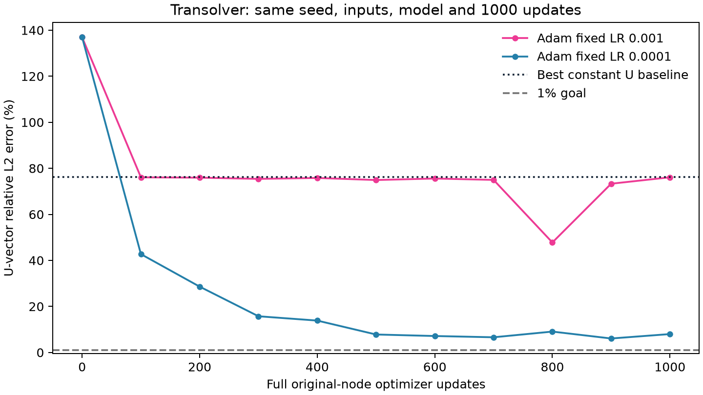

# Transolver拟合异常：接入正确性与学习率诊断

后续已完成[Transolver系列单/五样本6项重做](../stabilized_u_overfitting/README.md)，原版单样本最新U为2.3795%。本页7.9905%是此前仅改变固定学习率的独立诊断端点，保留作单变量证据，不再作为最新训练结果。

本报告检查此前U-only单样本Transolver的76.0923%异常结果。原16项固定1000步结果保留，不把本诊断的新配方替换到原主表。

直接对照本地固定官方源码路径与适配器，三个模型在513个真实原节点上、相同权重和随机数状态下，前向输出、完整参数梯度及一次Adam更新的差异均为0。TS3使用257节点分块，检查了跨块全局路径；TS++使用单rank并恢复Gumbel RNG。原版另做120,777全原节点的100步训练，检查点开启与关闭曲线完全相同。该覆盖范围内未发现输入拼接、检查点反向、优化器漏更新等接入错误，不宣称所有可能配置均已证明正确。

原节点U向量RMS为0.2949119 mm，所有节点预测同一个最佳平均位移时误差为76.1546%。旧原版1000步模型为76.0923%，预测节点空间变化相对范数仅4.05%，属于近常量预测；不是学到了完整位移场。固定1e-3的曲线先停在该基线附近，800步曾到47.7851%，1000步又退回76.0923%，显示未稳定收敛。

保存模型、U缩放与评估核对：原版与TS3的误差完全复现，缩放差为0，Adam已执行1000步。TS++因官方eval Gumbel随机性，重读为31.7057%而已存端点31.7058%，不是归一化或报告错误。

仅把原版单样本固定学习率从1e-3改为1e-4，其他科学条件保持相同、fresh seed2026、4,586,786参数、120,777完整节点、恰好1000更新，端点U从76.0923%变为7.9905%。100步小对照也由76.0821%变为42.7181%。这证明该固定配方对学习率敏感；仍须按新端点实际判断1%目标，不能把短探针或合成目标当作原物理U通过。

官方参考训练入口包含调度与部分梯度裁剪：原版exp_elas.py使用AdamW和CosineAnnealingLR；++ train_airplane.py使用Adam、OneCycleLR和clip_grad_norm_(1.0)；TS3 train_volume.py使用AdamW、余弦调度和clip_grad_norm_(1.0)。这些任务配方不直接证明适合本DeepJEB样本，但此前统一固定Adam .001、无调度、无裁剪不是官方收敛配方复现。固定配方对照不能据此断言Transolver架构记忆能力差。

另有参数口径修正：++原生embedding在condition=None输入路径不参与，包含1,152个注册可训练参数；本次梯度覆盖的活跃参数为4,609,512，而原表记录注册数4,610,664。两种计数均在460万±1%内，该差异不是76%误差原因。其余原版和TS3参数均参与所检查的反向路径。

三个513节点的合成坐标目标诊断显示能学习空间变化，500步训练误差原版4.3431%、++3.7947%、TS3 3.4927%；这不是物理U精度，也没有证明全部过拟合到1%。

正确性/短探针内部计时174.89秒UTC / 160.11秒单调时钟（该首轮计时不含模块导入）；独立学习率控制完整阶段210.29 / 192.56秒，含导入、数据、训练、读出、保存与退出。各阶段共享读取一份U-only缓存一次，stress/held-out读取0。所有新结果另行计费，原已关闭实验的预算未重置或延长。

[标量诊断记录](metrics.json) · [学习率曲线CSV](learning_rate_curve.csv) · [控制配置](../../configs/transolver_single_u_learning_rate_control.json) · [原U-only对照](../matched_capacity_u_overfitting/README.md)
