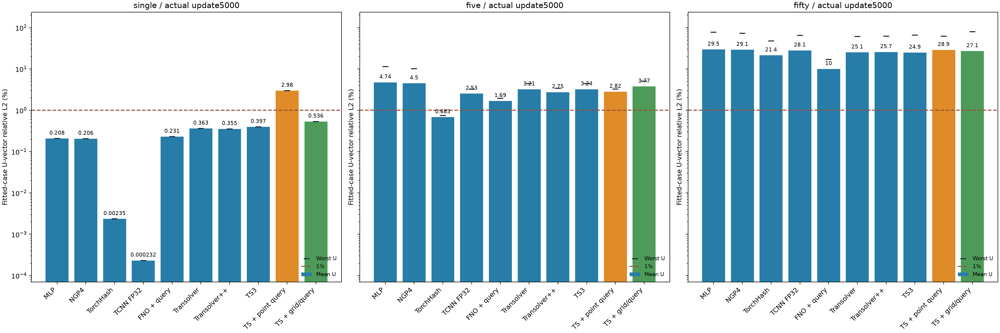
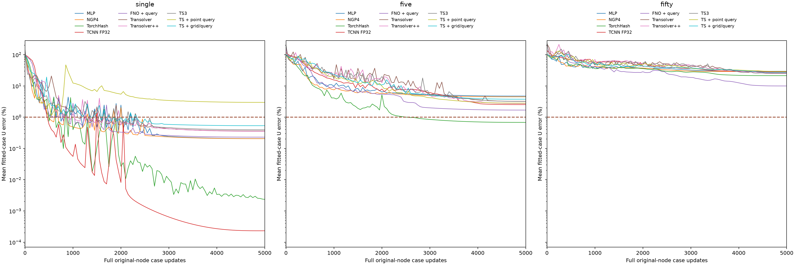

# Transolver查询头与网格化消融：1/5/50样本

历史30项端点保留；[最新MeshGraphNet单/五样本与32项精度/耗时比较](../meshgraphnet_single_five_u_overfitting/README.md)。MGN50未训练。

全部新增训练于北京时间2026-10-17T06:49:09.755071+08:00结束。两个原生阶段均exit0、closed/inactive、within_budget，精确guard/child均已退出。各1/5/50份端点预测和完整last.pt存在本地；导出仅读标量。

保留已有24项真实5000步端点，新增两种TS混合实现共6项，各freshseed2026且实际5000步。仅TRAIN U3拟合，非泛化测试，不挑best/partial。

TS + point query：官方原版非规则点骨干在全部原始点上产生16维隐特征，与原点XYZ+25条件拼接，44→376→376→3 GELU查询头。TS + grid/query：先用与FNO完全相同的64³占用+25维格点均值条件，再用官方原版非规则点TS处理全部262144格点，隐特征三线性插值回原点，与原XYZ+25条件进入同一个查询头。网格TS额外显式输入确定性的规则网格XYZ，为注意力提供位置；这来自网格索引，不含额外标签。FNO由FFT/网格结构表达空间关系。

两种TS骨干均5层/宽400/8heads/32slices/MLPratio1，latent16；查询头宽376。原版容量匹配TS宽408、直接输出U3；现有FNO查询头宽320。新增头计入约460万±1%注册/活跃参数预算，因此这是同预算的混合架构比较，不是保持每一层参数完全不变的纯加头实验，也不是论文默认配置原样复现。

统一Adam fused betas(.9,.999), eps1e-8, wd0；OneCycle5000/pct_start.1/peak1e-3/div25/finaldiv1000/cos两阶段/no momentum cycle；实际第1步4e-5、第500峰值.001、第5000步4e-8；clipL2=1，eval50，无早停。每update一完整原节点case，single5000遍、five各1000遍、fifty各100遍。U3signedmm/vectorrelativeL2²，组RMS仅拟合组；无sampleID/teacher/physicsU/stress/heldout输入。

两新增模型FP32且允许TF32，与原TS/FNO一致；表中TCNN为原生FP32 Cutlass且禁TF32。TS网格损失仍在原节点，不将真实U栅格化输入。两阶段各共享读取50个TRAIN U源一次，总100次；只为网格阶段构建所需格点缓存。所有模型/Adam/scheduler/四RNG/order/cursor及端点预测本地保留。

|方法|单样本U%|五样本均值%|五样本最差%|50样本均值%|50样本最差%|
|---|---:|---:|---:|---:|---:|
|MLP|0.207500|4.7428|11.3329|29.5333|77.0690|
|NGP4|0.205676|4.4985|10.1729|29.1136|73.1583|
|TorchHash|0.002353|0.6831|0.7506|21.3929|47.5205|
|TCNN FP32|0.000232|2.5335|3.2684|28.0900|64.6782|
|FNO + query|0.230503|1.6939|1.9405|9.9989|17.0790|
|Transolver|0.362831|3.2076|4.4722|25.1500|61.4277|
|Transolver++|0.354917|2.7529|3.4265|25.6559|62.0583|
|TS3|0.397055|3.2396|4.4200|24.9284|66.2128|
|TS + point query|2.983386|2.8212|3.2678|28.8945|61.8193|
|TS + grid/query|0.535807|3.7650|5.0513|27.0709|79.5382|

## 实际执行时间

时间单位秒，含模型构造、训练、全组评价和保存；不作为纯内核速度。

|方法|单样本|五样本|50样本|
|---|---:|---:|---:|
|MLP|258.45|341.59|728.48|
|NGP4|267.21|359.25|765.41|
|TorchHash|136.77|184.68|334.87|
|TCNN FP32|52.41|59.07|80.97|
|FNO + query|124.45|145.37|290.36|
|Transolver|834.67|1118.01|2109.01|
|Transolver++|2013.19|2834.12|5094.94|
|TS3|2280.70|3070.58|5567.23|
|TS + point query|832.43|1092.10|1888.71|
|TS + grid/query|1700.24|1747.79|2159.74|

新增两阶段合计9432.30s UTC / 8879.25s单调时钟，含共享加载/导入/退出；事件队列等候与第一阶段重叠，不重复累计。旧24项阶段成本保留于原报告。导出只读标量，模型/GT/科学数组读取0。

[全部30项和时间](all_methods.csv) · [560个逐案例端点](all_per_case.csv) · [新6项](summary.csv) · [原24项](../tcnn_fp32_u_overfitting/README.md)

## 消融结果解释

在同一5000更新配方和约460万参数预算下，新增查询头没有带来一致收益：

|实现|单样本相对原TS均值误差变化|五样本变化|50样本变化|
|---|---:|---:|---:|
|TS + point query|+722.25%|-12.05%|+14.89%|
|TS + grid/query|+47.67%|+17.38%|+7.64%|

上表是相对误差的百分比变化；负值表示改善，不是误差百分点。离散点查询头只在五样本均值上改善；其单样本和50样本均值均变差。网格TS三组均值均高于原版TS，50样本最差误差也从61.4277%升至79.5382%。网格模型在单样本上优于离散点混合模型，但不优于原TS。

FNO混合实现的五样本与50样本均值仍分别为1.6939%、9.9989%，低于两种TS混合实现。因而仅加相同形式的原点查询头、或再对齐网格化/插值，并未在本轮复制FNO的优势。该结论限定于当前实现、单seed和配方；没有证明FNO普遍优于TS，也没有确定剩余差异究竟来自算子归纳偏置、优化轨迹或其他架构细节。

两个新增TS模型骨干宽400、头宽376，旧TS宽408、FNO头宽320。总容量匹配引入了宽度调整；网格TS还需确定性的网格坐标作为注意力位置输入。这些差异使其不是严格保持所有其他层不变的单因素因果消融。精度、输入表示、每案例曝光次数及评价/保存开销也必须随表一起解释。

|新增实现／组|较原TS误差更低的案例数|案例总数|
|---|---:|---:|
|TS + point query / single|0|1|
|TS + point query / five|4|5|
|TS + point query / fifty|15|50|
|TS + grid/query / single|0|1|
|TS + grid/query / five|0|5|
|TS + grid/query / fifty|24|50|

[12项核心消融标量](ablation_comparison.csv) · [112个逐案例变化](per_case_delta_vs_TS.csv) · [50样本模型在相同五案例上的比较](same_five_cases.csv)
